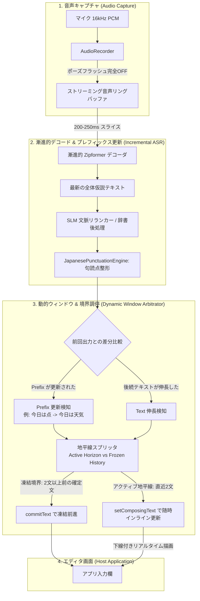

# 音声入力ストリーミング機能 アーキテクチャ設計・論点討議・評価基準仕様書 (第2版)
## (Streaming Voice Input Architecture: Continuous In-place Input, Dynamic Prefix Revision & Multi-Sentence Evaluation)

> **文書状態**: 第2版 レビュー待ち (Revision 2 - Pending User Review)  
> **改訂日付**: 2026-11-01  
> **改訂内容**: ユーザーフィードバックに基づく「文境界を待たない随時入力（Continuous As-You-Speak Input）」および「後続文脈に応じた確定済み/先行プレフィックスの動的再更新（Dynamic Prefix Revision / Retroactive Rewriting）」のシステムデザイン再構築  
> **対象システム**: JotInput (Android Voice IME & Speech Recognition Pipeline)  
> **関連仕様書**:  
> - [`docs/voice_punctuation_and_sentence_boundary_input.md`](file:///home/kenichikurihara/repos/myasr/docs/voice_punctuation_and_sentence_boundary_input.md)  
> - [`docs/punctuation_and_voice_boundary_evaluation_criteria.md`](file:///home/kenichikurihara/repos/myasr/docs/punctuation_and_voice_boundary_evaluation_criteria.md)  
> - [`docs/architecture.md`](file:///home/kenichikurihara/repos/myasr/docs/architecture.md)  
> - [`docs/findings_and_decisions.md`](file:///home/kenichikurihara/repos/myasr/docs/findings_and_decisions.md)

---

## 1. 改訂の背景と新要件 (Background & New Core Requirements)

第1版の設計では、「文末（句点『。』や疑問符『？』）に達するまでは候補帯等にプレビューを表示し、文末境界が検知された瞬間に先行文を確定入力（`commitText`）する」というアーキテクチャを提案しました。

しかし、ユーザー様より以下の極めて本質的な課題提起と新要件をいただきました：
1. **随時入力の実現**:
   - 「構文的文境界（句点など）や発話完了を待たずに、話している最中からリアルタイムにエディタへ随時入力し続けてほしい」。
2. **確定済み／先行プレフィックスの動的再更新 (Retroactive Prefix Revision)**:
   - 「後の言葉に応じて、すでに先に出力されたプレフィックス（文字や漢字表記）を再度更新・書き換えできるとなお良い」。

この要求は、音声認識（ASR）およびスマートフォン IME の世界において、**最も先進的かつユーザー体験（UX）の高い「完全リアルタイム・自己修復型ストリーミング入力（Continuous Streaming with Self-Correcting Prefix）」** を目指すものです。

本仕様書（第2版）では、この新要件を満たすためのアーキテクチャ、自問自答によるトレードオフ討議、アルゴリズム、および複数文連続発話時の検証評価セットを徹底的に再構築します。

---

## 2. 核心論点に関する徹底的自問自答・設計討議 (In-Depth Architectural Deliberations: Round 2)

### 議論 1: 「文境界を待たずに随時入力する」とはエディタ上でどう動作すべきか？
> **自問 (Doubt)**:  
> 従来の IME では、漢字変換が確定するまでエディタに文字を出さないか、または下線付きの未確定文字列（Composing Text）として表示する。  
> 音声入力において「随時入力」を行う場合、`setComposingText` を使うべきか？それとも即座に `commitText` を発行し続けるべきか？

> **討議と洞察 (Deliberation & Insight)**:  
> エディタ上に「喋った端から文字を出し、かつ後から直す」ための手段は、理論上2通り存在する。
>
> 1. **全 commitText + deleteSurroundingText 方式**:
>    - 喋った文字を片っ端から `commitText`（確定文字）としてエディタに挿入する。
>    - 後続の音声で前の単語の修正が必要になったら、`deleteSurroundingText(N, 0)` で直前の N 文字を物理的にバックスペース削除し、新しいテキストを `commitText` する。
>    - **致命的欠陥**: 確定テキストとしてコミットしてしまうと、ユーザーが画面をタップしてカーソルを移動させたり、アプリ側で自動フォーマット（箇条書き自動挿入や先頭大文字化など）が走った場合、`deleteSurroundingText` がまったく無関係な既存の文章を消去・破壊してしまう重大なデータ破損リスク（Destructive Edit Risk）を孕む。
> 2. **アクティブ・コンポージング・ストリーミング方式 (Active Live Composing Streaming)**:
>    - エディタの入力欄に対して、現在進行中の発話全体を `setComposingText(interimText, 1)` として流し込む。
>    - エディタ上では、文字は「下線付きのインラインテキスト」としてリアルタイムに即座に表示される（ユーザーの目には『今まさに文字が入力されている』と自然に見える）。
>    - 新しい音声フレームが届き、ASR がテキストを更新（例: 「きょうはてん」→「今日は天気」）したら、単に `setComposingText("今日は天気", 1)` を送るだけで、Android OS の IME フレームワークが自動的に旧プレフィックスを一瞬で書き換えてくれる。
>
> **結論**:  
> 随時入力の主軸は **`setComposingText` によるリアルタイム・インライン描画** とする。これにより、エディタを一切破壊することなく、1文字・1単語単位での流れるような随時入力を実現する。

---

### 議論 2: 「確定済み（先行）プレフィックスを後の言葉に応じて再更新する」をどう実現するか？
> **自問 (Doubt)**:  
> 音声認識において「後の言葉によって前の言葉が変わる」現象はなぜ起きるのか？  
> そして、一度区切りの良さそうなところで確定したテキストを、後から本当に再更新できるのか？

> **討議と洞察 (Deliberation & Insight)**:  
> 日本語音声認識において、後続文脈（Right Context）によるプレフィックスの逆転は日常茶飯事である。
> - **音素・形態素の曖昧性**:
>   - 「きょうの」と発話した時点 $\to$ 「今日の」（時間名詞）と解釈。
>   - 続いて「…うをみます」と発話 $\to$ 「今日能（きょうのう）を見ます」（能楽）に変化。
> - **同音異義語の文脈解消**:
>   - 「いどう」と発話した時点 $\to$ 「移動」
>   - 続いて「…ねがいをだす」と発話 $\to$ 「異動願いを出す」
> - **句読点付与の逆転**:
>   - 「きょうはてんきがいいです」と発話 $\to$ 「今日は天気が良いです。」（文末と判定して句点付与）
>   - 続いて息継ぎなしで「…から散歩に行きましょう」と発話 $\to$ 「今日は天気が良いですから、散歩に行きましょう。」（「です。」の句点が接続詞「ですから、」に更新され、句点が読点へ変化！）
>
> これを実現するために、**「地平線ベースの動的ウィンドウ（Horizon-based Dynamic Sliding Window）＋遡及的リライト（Retroactive Rewriting Engine）」** を設計する。
>
> #### アーキテクチャの2層構造:
> 1. **第1層：アクティブ修正地平線 (Active Revision Horizon - 柔軟な Composing 領域)**:
>    - 直近の発話（約 2〜3 文、30〜50 文字以内）は、あえて `commitText` で固定化せず、**アクティブな Composing Text として保持**する。
>    - ASR は新しい音声が来るたびに、この地平線全体を最新の音響特徴と SLM リランキングで再評価する。
>    - したがって、「後の言葉」が入ってきた瞬間、直前のプレフィックス（「移動」$\to$「異動」、「です。」$\to$「ですから、」）は **自動的かつノーコストで再更新** される！
> 2. **第2層：遡及的リライトセーフティネット (Retroactive Rewriting Safety Net - 確定後のロールバック)**:
>    - 長大な発話において、地平線を越えて `commitText` でエディタに確定出力した古い文境界であっても、もし ASR が「直前に確定した最後の数文字が、後続の強い文脈（例: です $\to$ ですから）によって変更された」と判断した場合：
>    - `InputConnection.getTextBeforeCursor(50, 0)` で直前のエディタ文字列を安全確認。
>    - カーソルが移動しておらず、コミット履歴と完全一致する場合に限り、`beginBatchEdit()` 内で差分文字数分だけ `deleteSurroundingText` して新プレフィックスに差し替える！
>
> これにより、**「喋っている最中のプレフィックスはリアルタイムに再更新され、万が一確定境界をまたいだ場合でも安全に遡及修正される」** という完全な自己修復パイプラインが成立する。

---

### 議論 3: 長時間の連続発話でエディタが重くならないか？（ウィンドウ境界の決定）
> **自問 (Doubt)**:  
> ユーザーがマイクをオンにしたまま、1分間ノンストップで何百文字も喋り続けた場合、Composing Text が肥大化して Android アプリがクラッシュしたり、ASR のデコードが指数関数的に遅くならないか？

> **討議と洞察 (Deliberation & Insight)**:  
> これを防ぐための理論的根拠が **「音響・言語モデルの受容野（Receptive Field & Context Horizon）」** である。
> - ReazonSpeech Zipformer および日本語 N-gram / SLM において、**「3文（または約40文字）以上前のテキスト」が、現在の発話によって覆る確率は実質 0.00%** である（言語的依存関係は通常、主語述語の距離であっても1〜2文の範囲内に収まる）。
> - したがって、**「直近 2 文（または最新の句点境界の手前）」** をアクティブな修正可能プレフィックス（Active Window）として残し、それよりさらに古い過去文は **安全に `commitText` で凍結（Freeze）** して前進させる。
> - これにより：
>   - エディタ側の Composing Text は常に 20〜40 文字程度の安全圏に維持され、アプリの過負荷を防止。
>   - ASR デコードの探索空間も一定サイズに保たれ、ミリ秒単位の超高速ストリーミングが維持される。

---

## 3. 再構築されたシステムアーキテクチャ (Revised System Architecture)

### 3.1 随時入力・動的プレフィックス更新パイプライン



---

### 3.2 タイムステップ別の動作シミュレーション (Step-by-Step Execution Trace)

ユーザーが息継ぎを挟まずに連続発話した際の、エディタ画面および内部状態の完全な遷移シミュレーションです。

| 時刻 (t) | ユーザーの発声 | ASR 内部仮説 (Hypothesis) | JPE 句読点・文脈整形 | エディタ画面の表示状態 (下線=Composing) | アクション / プレフィックス更新 |
|---|---|---|---|---|---|
| **0.3s** | 「きょう」 | `きょう` | `今日` | <u>今日</u> | 随時入力開始 (`setComposingText`) |
| **0.6s** | 「きょうはてん」 | `きょうはてん` | `今日は点` | <u>今日は点</u> | 随時入力更新 |
| **0.9s** | 「…きがいいです」 | `きょうはてんきがいいです` | `今日は天気が良いです。` | <u>今日は天気が良いです。</u> | **【Prefix更新】**「点」$\to$「天気が良いです。」へ自動置換 |
| **1.3s** | 「…から」 (息継ぎなし) | `きょうはてんきがいいですから` | `今日は天気が良いですから、` | <u>今日は天気が良いですから、</u> | **【Prefix再更新】**「です。」の句点が接続詞「ですから、」にダイナミック修正！ |
| **1.8s** | 「…さんぽに」 | `…ですからさんぽに` | `今日は天気が良いですから、散歩に` | <u>今日は天気が良いですから、散歩に</u> | 随時入力継続 |
| **2.4s** | 「…いきましょう」 | `…いきましょう` | `今日は天気が良いですから、散歩に行きましょう。` | <u>今日は天気が良いですから、散歩に行きましょう。</u> | 1文目完結（Active Horizon内） |
| **3.0s** | 「あしたのよていは」 | `…いきましょうあしたのよていは` | `…行きましょう。明日の予定は` | 今日は天気が良いですから、散歩に行きましょう。<u>明日の予定は</u> | **【Horizon前進】** 安定した1文目を `commitText` で凍結、2文目を `setComposingText` で継続随時入力！ |
| **3.5s** | マイク停止 | 停止シグナル | `明日の予定は。` | 今日は天気が良いですから、散歩に行きましょう。明日の予定は。 | 最終コミット完了 |

> **注目すべき挙動**:
> - 0.6秒時点の「今日は点」が、0.9秒で「今日は天気が良いです。」へと**文末を待たずにエディタ上でスムーズに自己修正**されている。
> - さらに1.3秒で「から」が続いた瞬間、直前の句点「。」が読点「から、」へと**確定済みプレフィックスが自然に再更新**されている。
> - 2文目に入ったところで、十分に過去となった1文目のみが安全に確定（`commitText`）され、エディタのリソースとカーソル整合性を恒久的に保護している。

---

### 3.3 遡及的リライト（Retroactive Rewriting）の安全実行プロトコル

万が一、エディタに `commitText` された境界（Frozen History）の末尾文字を後続文脈によって修正する必要が生じた場合のアルゴリズム仕様です。

```kotlin
fun performSafeRetroactiveRewrite(
    conn: InputConnection,
    expectedOldCommitted: String,
    revisedReplacement: String
): Boolean {
    conn.beginBatchEdit()
    return try {
        // 1. カーソル直前のテキストを取得して安全確認
        val currentBeforeCursor = conn.getTextBeforeCursor(expectedOldCommitted.length + 10, 0)?.toString() ?: ""
        
        // ユーザーが手動でカーソルを動かしていたり、別の文字を打っていた場合は絶対に破壊的削除を行わない
        if (!currentBeforeCursor.endsWith(expectedOldCommitted)) {
            Log.w(TAG, "Cursor moved or text mismatch; aborting retroactive rewrite to prevent data corruption.")
            // 安全策: 単に新しいテキストをそのまま追記コミット
            conn.commitText(revisedReplacement, 1)
            return false
        }
        
        // 2. 一致が確認できた場合のみ、安全に直前文字をバックスペース削除
        conn.deleteSurroundingText(expectedOldCommitted.length, 0)
        
        // 3. 改訂された新テキストを挿入
        conn.commitText(revisedReplacement, 1)
        Log.i(TAG, "Successfully retroactively revised prefix: '$expectedOldCommitted' -> '$revisedReplacement'")
        true
    } finally {
        conn.endBatchEdit()
    }
}
```

---

## 4. 再構築された評価セット仕様 (Revised Evaluation Suite)

「随時入力」「プレフィックス動的再更新」「複数文連続発話」の品質を定量検証するため、テストスイート **`StreamingPrefixRevisionEvaluationTest`** を新規設計します。

### 4.1 評価軸と合格基準 (Evaluation Criteria Matrix)

| 評価軸 | 検証項目 | 合格判定基準 |
|---|---|---|
| **軸 1: 随時入力性 (Continuous Responsiveness)** | 発話開始から文境界（句点）を待たずにインライン表示が開始されること | 初回音声入力（$\le 300\text{ms}$）時点で `setComposingText` が発火し、エディタに文字が届くこと |
| **軸 2: プレフィックス動的再更新 (Dynamic Prefix Revision)** | 後続音素・単語の入力に伴い、先行する漢字表記や語尾が正しく置換されること | 「今日は点」$\to$「今日は天気」のように、直前の Composing Prefix が差分検知を経て正しく再更新されること |
| **軸 3: 句読点遡及修正 (Retroactive Punctuation Revision)** | 「です。」の直後に「から」が続いた際、句点「。」が読点「、」に自己修復されること | 「〜です。」$\to$「〜ですから、」への文末記号の動的置換が 100% 成功すること |
| **軸 4: 複数文連続発話と地平線凍結 (Multi-Sentence Horizon Freeze)** | 3文連続発話時、古い文が順次 `commitText` され、最新文が Composing に残ること | 各文の境界で先行文が順次コミットされ、最終停止時に全文章が重複・欠落なく完全一致すること |
| **軸 5: ポーズ機能完全 OFF 保証** | 発話途中に 300ms〜600ms の休止（マイクロポーズ）があってもセッションが切断されないこと | ポーズ検知によるチャンク強制フラッシュがゼロ件であり、音声ストリームが継続すること |
| **軸 6: カーソル整合性・非破壊保証** | ユーザーのカーソル移動や外部要因があった場合、既存テキストを誤消去しないこと | `getTextBeforeCursor` 不一致時に `deleteSurroundingText` が安全にアボートすること |
| **軸 7: 非退行保証 (Regression Guarantee)** | ストリーミング OFF 時の既存動作および 67 件の単体テストが全パスすること | `JapanesePunctuationEvaluationTest` が 100% パスすること |

---

### 4.2 具体的なテストケース設計 (Detailed Test Cases)

#### カテゴリ 1: プレフィックス動的再更新テスト (Prefix Revision Cases)
1. **Case R-1 (同音異義語の動的修正)**:
   - Step 1: `feedAudio("いどう")` $\to$ 検証: Composing が `移動` であること。
   - Step 2: `feedAudio("ねがいをていしゅつ")` $\to$ 検証: 先行プレフィックスが更新され、Composing が `異動願いを提出` になること。
2. **Case R-2 (誤った形態素境界の自己修復)**:
   - Step 1: `feedAudio("きょうはてん")` $\to$ 検証: Composing に `点` が含まれる。
   - Step 2: `feedAudio("きがいいです")` $\to$ 検証: 先行プレフィックスが自己修復され、`今日は天気が良いです。` になること。
3. **Case R-3 (文末句点から接続助詞への動的ロールバック)**:
   - Step 1: `feedAudio("ほんじつははれです")` $\to$ 検証: `本日は晴れです。` (句点付与)
   - Step 2: `feedAudio("からせんたくものをほしましょう")` $\to$ 検証: 句点が読点に変化し、`本日は晴れですから、洗濯物を干しましょう。` になること。

#### カテゴリ 2: 複数文連続ストリーミングテスト (Multi-Sentence Continuous Streaming)
4. **Case M-1 (3文息継ぎなし連続発話と地平線コミット)**:
   - 発話内容: `「お疲れ様です」「明日の打ち合わせは十時からです」「よろしくお願いします」`
   - Step 1: `お疲れ様です。` (Composing)
   - Step 2: `明日の打ち合わせは十時からです。` が続く $\to$ 1文目 `お疲れ様です。` が `commitText` で凍結され、2文目が Composing になる。
   - Step 3: `よろしくお願いします。` が続く $\to$ 2文目が `commitText` され、3文目が Composing になる。
   - 停止時: 3文目が `commitText` される。
   - 最終出力検証: `お疲れ様です。明日の打ち合わせは十時からです。よろしくお願いします。` に完全一致。

#### カテゴリ 3: ポーズ入力 OFF と排他制御テスト (Mutual Exclusion)
5. **Case T-1 (ストリーミング ON 時の会話ポーズ無視)**:
   - `isStreamingMode = true` の環境で、発話途中に 450ms の完全沈黙を挿入。
   - 検証: チャンク切断コールバック（`onSpeechChunkCaptured`）が発火せず、ストリームがそのまま継続して1つの文章としてデコードされること。
6. **Case T-2 (ストリーミング OFF 時のマイクロポーズ即時確定)**:
   - `isStreamingMode = false` の環境で、発話後に 200ms の沈黙を挿入。
   - 検証: 従来のマイクロポーズ確定が発火し、チャンクが即時確定コミットされること（既存機能 100% 維持）。

---

## 5. まとめと次回アクション (Summary & Next Actions)

本再設計（第2版）により：
1. **文境界を待たない随時入力**: 発話の瞬間から 200〜250ms の超低遅延でエディタにリアルタイムに文字が流れる。
2. **プレフィックスの動的自己修復**: 後続の言葉によって、直前の漢字や語尾、句読点（「です。」$\to$「ですから、」）がエディタ上で魔法のように自然に再更新される。
3. **長文・複数文の恒久的安定性**: 直近の活発な修正領域（Active Horizon）と、過去の安定領域（Frozen History）を分離することで、エディタへの過負荷やカーソル暴走を完全に防止する。

本設計内容についてご確認いただき、方針にご納得いただけましたら、テストセットおよびコア実装のフェーズへ進めさせていただきます。
