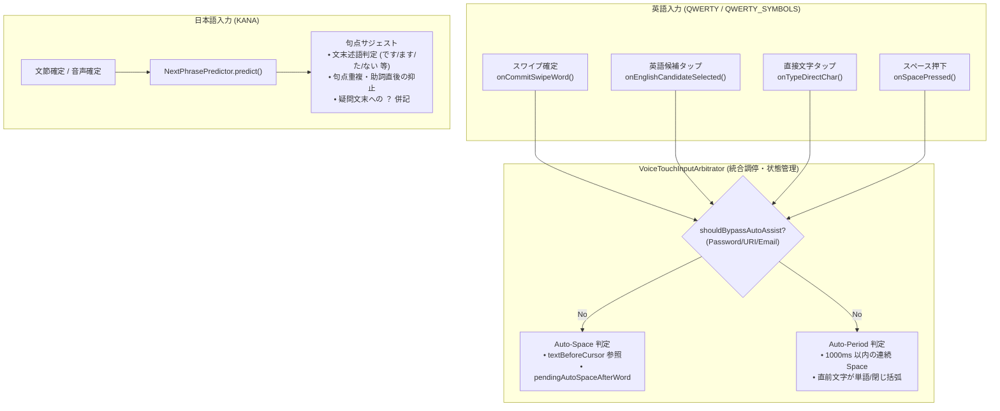

# システム設計書: 英語自動スペース・自動ピリオド（Gboard方式）および日本語句点サジェストのホリスティック統合

## 1. 概要 (Executive Summary)

本ドキュメントは、JotInput における以下の 3 つの入力支援機能を**ホリスティック（全体的・統合的）**に設計・統合するための技術仕様書である。

1. **英語入力の自動スペース (English Auto-Space)**:
   現在 [`VoiceTouchInputArbitrator`](file:///home/antigravity/kenichikurihara/jotinput/app/src/main/java/com/example/myasr/VoiceTouchInputArbitrator.kt) に存在するスワイプ入力時の簡易的な自動スペース（`lastCommittedWasSwipe` 単一フラグ依存）を刷新し、**スワイプ入力・タップ入力・候補チップ選択・音声入力・句読点入力**の間で一貫して破綻しない「遅延前置スペース（Lazy Prepend Auto-Space）」アーキテクチャへ再設計する。
2. **英語入力の自動ピリオド (English Auto-Period)**:
   Gboard を参考に、英単語の直後にスペースキーを素早く 2 回押下（Double-Space）した際に、`"<word> "` を `"<word>. "` へ自動変換する機能を実装する。
3. **日本語の句点サジェスト (Japanese Period `。` Suggestion)**:
   [`NextPhrasePredictor`](file:///home/antigravity/kenichikurihara/jotinput/app/src/main/java/com/example/myasr/NextPhrasePredictor.kt) によるゼロクエリ次文節予測に、文末述語・文脈に応じた句点（`。` および疑問文末の `？`）のサジェストを統合し、フリック入力・確定直後のワンタップ句点入力を実現する。

---

## 2. 現状の課題とホリスティック再設計の必要性

### 2.1 既存の簡易実装における問題点

1. **`lastCommittedWasSwipe` 単一フラグの限界**:
   - **通常タップ語 + スワイプ語の結合バグ**: ユーザーが `"hello"` をタップ入力（または候補選択）し、スペースを押さずに次の単語 `"world"` をスワイプ入力した場合、`lastCommittedWasSwipe` が `false` のため `"helloworld"` と結合してしまう。
   - **英語候補チップ選択時のバイパス問題**: [`VoiceInputMethodService.kt`](file:///home/antigravity/kenichikurihara/jotinput/app/src/main/java/com/example/myasr/VoiceInputMethodService.kt#L447-L465) で `english_typo` / `english_cap` / `user_english` / `raw` 候補をタップした際、`arbitrator` を経由せず `editorBridge` を直接操作しているため、自動スペース状態・インフライト音声デコード追跡（`inFlightDecodes`）・`previousCommittedPhrase` が更新されない。
   - **文末句読点後のスワイプ入力**: `"hello."` の後に次の文をスワイプ（`"world"`）すると、`.` の直後にスペースが入らず `"hello.world"` になってしまう。一方で、タップ入力で `"google.com"` や `"3.14"` を入力する際にはスペースを入れてはならない。
2. **自動ピリオドの欠如**:
   - 英語 QWERTY 入力時にスペース 2 回でピリオド＋スペース（`". "`）を挿入する機能が未実装であり、ピリオドキーへの指の移動コストが高い。
3. **日本語入力時の句点（`。`）サジェストの欠如**:
   - [`NextPhrasePredictor`](file:///home/antigravity/kenichikurihara/jotinput/app/src/main/java/com/example/myasr/NextPhrasePredictor.kt) はユーザーバイグラム・定型コロケーション・文頭挨拶・助詞（`は`, `が`, `を` 等）を予測するが、`"完了しました"` や `"お願いします"` のような文末表現を確定した直後に `。` を候補バーに提示しない。

### 2.2 設計原則

- **遅延前置スペース（Lazy Prepend）の維持**: 単語確定時に末尾スペースを先回り挿入しない。代わりに「次のトークンがスペースを必要とするか」を確定時に判定して前置する。これにより、`.` や `,` などの句読点入力時に不要なスペース削除処理が不要になる。
- **コンテキスト・バイパス（安全性）**: パスワード、メールアドレス、URL、`TYPE_TEXT_FLAG_NO_SUGGESTIONS` フィールドでは自動スペースおよび自動ピリオドを自動的に無効化する。
- **音声入力・既存契約との非干渉**: [`VoiceTouchInputArbitrator`](file:///home/antigravity/kenichikurihara/jotinput/app/src/main/java/com/example/myasr/VoiceTouchInputArbitrator.kt) の「Single-Composing Ownership」「Chronological Ordering」および [`JapanesePunctuationEvaluationTest`](file:///home/antigravity/kenichikurihara/jotinput/app/src/test/java/com/example/myasr/JapanesePunctuationEvaluationTest.kt)（音声句読点 67+ テスト）を 100% 維持する。
- **UI シンプルさ原則の遵守**: [`docs/ui_design_and_simplicity_guidelines.md`](file:///home/antigravity/kenichikurihara/jotinput/docs/ui_design_and_simplicity_guidelines.md) に従い、これらは Gboard 準拠の最適デフォルト動作として `MainActivity` の設定カードを増やさずに提供する（内部設定フラグは `KeyboardHeightManager` に集約しデフォルト `true`）。

---

## 3. 全体アーキテクチャと状態遷移

---

## 4. 詳細設計 1: 英語自動スペース (English Auto-Space)

### 4.1 状態変数

[`VoiceTouchInputArbitrator`](file:///home/antigravity/kenichikurihara/jotinput/app/src/main/java/com/example/myasr/VoiceTouchInputArbitrator.kt) に以下の状態を保持する：
- `lastCommittedWasSwipe: Boolean`: 直前の操作がスワイプ確定（またはその代替候補選択）であるか（`onDeletePressed` の単語一括削除判定に引き続き使用）。
- `pendingAutoSpaceAfterWord: Boolean`: 直前の操作が **スワイプ単語確定** または **英語候補チップ選択**（`onEnglishCandidateSelected`）であり、次の文字タップ時に前置スペースを挿入する候補状態であるか。
  - `onTypeDirectChar`、`onDeletePressed`、`onSpacePressed`、`onEnterPressed`、`onBeforeNavigationOrAction`、`resetAll`、音声コミット時に `false` にリセットされる。

### 4.2 トリガー別マトリクス

| 直前のコンテキスト (`textBeforeCursor` / 状態) | 次の入力操作 | 動作（`!bypass` 時） | 出力例 |
| :--- | :--- | :--- | :--- |
| 空、または空白文字（` `, `\n`, `\t`）で終了 | スワイプ `"world"` | スペースなし | `"world"` |
| 英数字（`a-z`, `A-Z`, `0-9`）で終了（タップ語・音声語・スワイプ語問わず） | スワイプ `"world"` | **前置 `" "`** | `"hello world"` |
| 文末/区切り記号（`.`, `,`, `!`, `?`, `;`, `:`, `)`, `]`, `}`, `%`）で終了 | スワイプ `"world"` | **前置 `" "`** | `"hello. world"` |
| 開始記号・識別子記号（`(`, `[`, `{`, `/`, `@`, `#`, `$`, `_`, `-`）で終了 | スワイプ `"world"` | スペースなし | `"@world"`, `"(world"` |
| `pendingAutoSpaceAfterWord == true`（スワイプ直後・英語候補選択直後） | タップ英数字（`b`, `2`） | **前置 `" "`**（ただし既に空白末尾なら不要） | `"foo b"` |
| `pendingAutoSpaceAfterWord == true` | タップ記号（`.`, `,`, `!`, `?`, `'`） | スペースなし（直結） | `"foo."`, `"foo,"` |
| 通常タップ入力中（`pendingAutoSpaceAfterWord == false`） | タップ `.` → タップ `c` | スペースなし | `"google.com"`, `"3.14"` |
| 英語候補チップタップ (`onEnglishCandidateSelected`) | `"hello"` を選択 | 置換コミットし `pendingAutoSpaceAfterWord = true` | `"hello"`（次入力へ待機） |

### 4.3 英語候補タップの Arbitrator 統合 (`onEnglishCandidateSelected`)

[`VoiceInputMethodService.kt`](file:///home/antigravity/kenichikurihara/jotinput/app/src/main/java/com/example/myasr/VoiceInputMethodService.kt#L447-L465) の `english_typo`, `english_gec`, `user_english`, `english_cap`, `raw` 処理を [`VoiceTouchInputArbitrator.onEnglishCandidateSelected`](file:///home/antigravity/kenichikurihara/jotinput/app/src/main/java/com/example/myasr/VoiceTouchInputArbitrator.kt) へ移管する。
- `deleteSurroundingText(replaceLength, 0)` + `commitText(candidateSurface, 1)` を `beginBatchEdit`/`endBatchEdit` 内で実行。
- `recordDeleteCharsForInFlightDecodes` / `recordDirectCommitForInFlightDecodes` を正しく呼び出し、音声との時系列順序を保証。
- `pendingAutoSpaceAfterWord = !isSentenceEndPunctuation(candidateSurface)` を設定（`english_gec` を含む）。

### 4.4 バイパス条件 (`shouldBypassAutoAssist`)

[`EnglishCapitalizationAnalyzer.shouldBypassCapitalization`](file:///home/antigravity/kenichikurihara/jotinput/app/src/main/java/com/example/myasr/EnglishCapitalizationAnalyzer.kt#L64-L95) と同等基準に加え、入力モードも考慮する：
- `EditorInfo` がパスワード（`TYPE_TEXT_VARIATION_PASSWORD`, `VISIBLE_PASSWORD`, `WEB_PASSWORD`, `NUMBER_VARIATION_PASSWORD`）、メールアドレス（`TYPE_TEXT_VARIATION_EMAIL_ADDRESS`）、URI（`TYPE_TEXT_VARIATION_URI`）、または `TYPE_TEXT_FLAG_NO_SUGGESTIONS` の場合は `true`。
- 英語自動スペース／自動ピリオドは `KeyboardMode.QWERTY`（および `QWERTY_SYMBOLS`）時のみ有効（`KANA` / `NUMBER` では無効）。

---

## 5. 詳細設計 2: 英語自動ピリオド (Gboard 方式 Double-Space)

### 5.1 状態変数と定数

- `DOUBLE_SPACE_TIMEOUT_MS = 1000L`（1.0 秒以内の 2 回目スペース押下で発動）
- `lastAutoPeriodEligibleSpaceTimeMs: Long = 0L`（テスト容易性のため `nowMs: Long = System.currentTimeMillis()` を引数に取れる設計とする）

### 5.2 発動アルゴリズム (`onSpacePressed`)

1. **1 回目のスペース押下時**（英語モード・`autoPeriodEnabled && !bypassAutoAssist`）:
   - `composingText` や `streamingLastComposingText` があれば先に確定する。
   - コミット**前**の `editor.getTextBeforeCursor(2, 0)` を確認し、末尾文字が「ピリオド付与対象（`isAutoPeriodEligiblePrecedingChar`）」であるか判定する：
     - **対象文字**: `Character.isLetterOrDigit(ch)` または閉じ括弧・引用符・パーセント（`')'`, `']'`, `'}'`, `'"'`, `'\''`, `'%'`）。
     - **非対象文字**: 空文字、空白文字（`' '`, `'\n'`, `'\t'`）、句読点・記号（`'.'`, `','`, `'!'`, `'?'`, `';'`, `':'`, `'-'`, `'_'`, `'/'`, `'@'` 等）。
   - `" "` をコミットする。
   - 対象文字であった場合のみ `lastAutoPeriodEligibleSpaceTimeMs = nowMs` を記録する。それ以外は `0L` にリセット。

2. **2 回目のスペース押下時**:
   - 条件チェック：
     1. `autoPeriodEnabled && !bypassAutoAssist`
     2. `spaceCharWhenIdle == " "`
     3. `composingText.isEmpty() && streamingLastComposingText.isEmpty()`
     4. `lastAutoPeriodEligibleSpaceTimeMs > 0L && (nowMs - lastAutoPeriodEligibleSpaceTimeMs) <= DOUBLE_SPACE_TIMEOUT_MS`
     5. 現在の `editor.getTextBeforeCursor(2, 0)` が `" "` で終わり、かつその 1 つ前の文字が `isAutoPeriodEligiblePrecedingChar` を満たす（カーソル移動や他アプリ編集が挟まっていないことの二重検証）。
   - 条件をすべて満たす場合：
     - `beginBatchEdit()` → `deleteSurroundingText(1, 0)` → `commitText(". ", 1)` → `endBatchEdit()`
     - `inFlightDecodes` の記録を 1 文字削除＋`". "` 追加で更新。
     - `lastAutoPeriodEligibleSpaceTimeMs = 0L` にリセット（**3 回目のスペースで `".. "` になるのを防止**）。
     - `previousCommittedPhrase = "."`（または末尾コンテキスト更新）。
     - `SpaceOutcome.CONVERTED_DOUBLE_SPACE_TO_PERIOD` を返す。

### 5.3 連動動作とエッジケース

- **大文字化との連動**: 自動ピリオドで `". "` が挿入されると、直後の英単語入力時に [`EnglishCapitalizationAnalyzer`](file:///home/antigravity/kenichikurihara/jotinput/app/src/main/java/com/example/myasr/EnglishCapitalizationAnalyzer.kt) が自動的に `SENTENCE_START` と判定し、先頭大文字候補を提示する。
- **GEC（文法訂正）との連動**: `CONVERTED_DOUBLE_SPACE_TO_PERIOD` 時はすでに文がピリオドで閉じているため、無駄な句中 GEC を走らせず候補バーをクリーンな状態に保つ。
- **他操作によるリセット**: `onTypeKana`, `onTypeDirectChar`, `onCommitSwipeWord`, `onEnglishCandidateSelected`, `onDeletePressed`, `onEnterPressed`, `onBeforeNavigationOrAction`, `onExternalSelectionUpdated`, `resetAll` のいずれかが呼ばれたら `lastAutoPeriodEligibleSpaceTimeMs = 0L` にリセットする。

---

## 6. 詳細設計 3: 日本語の句点（`。`）サジェスト

### 6.1 設計方針

[`NextPhrasePredictor.predict(lastPhrase, textBeforeCursor)`](file:///home/antigravity/kenichikurihara/jotinput/app/src/main/java/com/example/myasr/NextPhrasePredictor.kt#L155-L240) に**日本語句点サジェスト層**を統合する。

### 6.2 抑止ルール（`。` を出さないケース）

以下のいずれかに該当する場合、句点（`。`）サジェストを**抑止**する：
1. `cleanLast.isEmpty()` かつ `textBeforeCursor.trim()` が空（文頭・空白）。
2. `isSentenceStart` が `true`（直前が `。`, `！`, `？`, `.`, `!`, `?`, `\n` で終わっている）。
3. `cleanLast` が読点・開始括弧・中黒で終わっている（`、`, `,`, `・`, `（`, `「`, `『`, `【`, `(`）。
4. `cleanLast` が**終助詞以外の格助詞・接続助詞**（`は`, `が`, `を`, `に`, `で`, `の`, `と`, `も`, `へ`, `から`, `まで`, `より`, `ので`）で終わっている。
   - ※ 終助詞（`か`, `よ`, `ね`, `わ`, `な`）や文末助動詞（`です`, `ます`, `た`, `だ`, `ない`）は文末になり得るため抑止しない。

### 6.3 優先度と文末述語ヒューリスティック

`NextPhrasePredictor.predict()` 内の候補優先順位を以下の通り設計する：

1. **ユーザー学習バイグラム (`history_bigram`)** — ユーザー固有の学習結果を最優先。
2. **定型コロケーション (`canonical_collocation`)** — 例: `"ありがとう"` → `"ございます"`。
3. **文末述語判定 (`isSentenceEndingPredicate(cleanLast)`) による高優先句点サジェスト**:
   - `cleanLast` が以下の文末パターンで終わる場合：
     - 丁寧・敬語・過去・否定・推量・依頼系：`ます`, `ました`, `ません`, `でした`, `です`, `ございます`, `いたします`, `おります`, `あります`, `います`, `ください`, `しょう`, `たい`, `ない`, `なかった`, `った`, `いた`, `んだ`, `だ`
     - 終助詞系：`ますか`, `ましたか`, `ですか`, `でしょうか`, `かな`, `よね`, `だよ`, `だね`
   - これらに該当する場合、助詞候補（`は`, `が`, `を`...）よりも**先**に `。`（`source = "punctuation_suggestion"`）を提示する。
   - さらに疑問文末（`か`, `でしょうか`, `かな` で終わる場合）は `？` も `。` の直後に提示する。
4. **一般助詞 (`particle`)** — 名詞等の場合は引き続き格助詞を優先。
5. **フォールバック句点サジェスト**:
   - 名詞など文末述語に該当しないが抑止ルールにも該当しない語句（例：`"東京"`, `"問題なし"`, `"了解"`）の直後にも、助詞の後に `。`（および `、`）を提示し、常にワンタップで文を閉じられるようにする。

### 6.4 発火ポイント（`VoiceInputMethodService`）

- 12 キーフリックで日本語候補を確定した直後（`showNextPhrasePredictions(committedPhrase)`）：既存の導線で即座に `。` が候補バーに表示される。
- `onStartInputView` や `KANA` モードへの切替時に `textBeforeCursor` 末尾が日本語文節（かつ句読点でない）場合も、必要に応じて予測可能とする。
- 候補バーで `。` がタップされた場合、`isPrediction = true` として `arbitrator.onCandidateSelected` が `"。"` をコミットし、`previousCommittedPhrase = "。"` となるため、直後の `showNextPhrasePredictions("。")` は自動的に文頭サジェスト（`お疲れ様です`, `また、` 等）へ切り替わる。

---

## 7. 検証計画 (Verification & Test Plan)

以下の単体テストを実装・拡充し、全件パスを確認する：

1. **英語自動スペース・自動ピリオド単体テスト**:
   - [`FutoSwipeIntegrationTest.kt`](file:///home/antigravity/kenichikurihara/jotinput/app/src/test/java/com/example/myasr/FutoSwipeIntegrationTest.kt) の更新および新規テスト追加：
     - スワイプ連続入力、タップ語→スワイプ語、句読点（`.`）後→スワイプ語（`"hello. world"`）、英語候補タップ→次タップ文字（`"hello w"`）・次記号（`"hello."`）。
     - Gboard 方式ダブルスペース自動ピリオド（`"hello"` + Space + Space ≤ 1000ms → `"hello. "`）。
     - タイムアウト超過（> 1000ms）時は自動ピリオド不発（`"hello  "`）。
     - 句読点直後（`"hello."` + Space + Space）・トリプルスペース・空白直後・パスワード/URI バイパス時に自動ピリオド不発。
     - 自動ピリオド後の `EnglishCapitalizationAnalyzer` 文頭大文字化連動確認。
2. **日本語句点サジェスト単体テスト**:
   - [`NextPhrasePredictorTest.kt`](file:///home/antigravity/kenichikurihara/jotinput/app/src/test/java/com/example/myasr/NextPhrasePredictorTest.kt) に追加：
     - 文末述語（`"完了しました"`, `"大丈夫です"`, `"確認します"`）直後に `。` が最上位付近にサジェストされること。
     - 疑問文末（`"大丈夫ですか"`）直後に `。` および `？` がサジェストされること。
     - 文頭（`""`）、句点直後（`"完了しました。"`）、読点直後（`"また、"`）、格助詞直後（`"会議で"`）では `。` がサジェストされないこと。
     - サブミリ秒（`< 1000 µs`）レイテンシ維持。
3. **トップライン非回帰テスト**:
   - [`JapanesePunctuationEvaluationTest`](file:///home/antigravity/kenichikurihara/jotinput/app/src/test/java/com/example/myasr/JapanesePunctuationEvaluationTest.kt) を含む全テストスイートの 100% パス。
