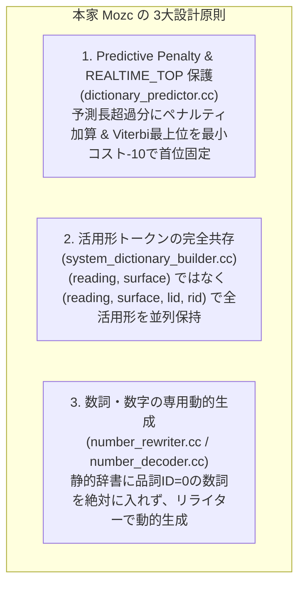

# システムデザインドキュメント: 動詞活用形保護・連接ノイズ除去 & 候補整流化
## Corpus-Driven Conjugation Preservation, Noise Token Purging, and Candidate Rectification

**著者**: Antigravity (Google DeepMind Advanced Agentic Coding)  
**作成日**: 2026-11-01  
**ステータス**: 設計完了・実装前レビュー済  
**関連文書**:
- [`docs/system_design_mozc_integration_and_flick_correction.md`](file:///home/kenichikurihara/repos/myasr/docs/system_design_mozc_integration_and_flick_correction.md)
- [`docs/dictionary_system_redesign.md`](file:///home/kenichikurihara/repos/myasr/docs/dictionary_system_redesign.md)
- [`docs/findings_and_decisions.md`](file:///home/kenichikurihara/repos/myasr/docs/findings_and_decisions.md)

---

## 1. 背景と根本課題の分析

本プロジェクトのかな漢字変換システムにおいて、以下の2つの重大な変換欠落事象がユーザーから報告され、デバッグによってその根本原因が特定されました。

### 課題A: 「いえの」に対して「家の」が候補に出ない（第76位〜第78位へ埋没）
1. **前方一致予測語の無差別先行挿入（Finding 32）**:
   - 辞書内に存在する「家の外」「家の中」「家の鍵」「家の掃除」など 111 件の「いえの〜」複合語が、Trie の前方一致予測マッチ（`collectPrefixWords`）によって最大 80 件抽出され、連文節変換（Viterbi）候補よりも前に無差別に挿入されていた。
   - その結果、ユーザーが「いえの」と打ち終えた時点で、画面に見える候補枠（通常 3〜5 件）がすべて複合語予測で埋め尽くされ、完全一致・文節変換候補である「家の」が第 76〜78 位へと押し流されていた。
2. **Viterbi ビーム幅（beamWidth = 6）の過小設定**:
   - 連文節変換の出力上限が 6 件と極端に小さく、助詞「の」のカタカナ・当て字（「いえノ」「言え之」など）で枠が埋まり、「家の」が枝刈り消滅するリスクを抱えていた。

### 課題B: 「でません」に対して「出ません」が候補に一切出ない（消失して「で魔1000」等が出現）
1. **辞書ビルドにおける活用形の破壊的重複排除（主因）**:
   - `tools/mozc_dict/build_base_dictionary.py` において、`key = (reading, surface)` による重複排除（deduplicate）が行われていた。
   - Mozc OSS 公式辞書には、一段動詞「出る」の未然形（`で\t698\t698\t38\t出`）と連用形（`で\t705\t705\t43\t出`）が共存していたが、未然形（cost=38）の方がコストが 5 低いため、**連用形（705）が破棄され、未然形（698）のみが抽出**されていた。
   - 助動詞「ません」（POS ID: 659）は連用形接続であるため、未然形（698）からの接続コストが **11,315（大ペナルティ）** となり、文法的に正しい「出ません」のパスが Viterbi 探索で完全に死滅していた。
   - 同様に、「出ました」（705 $\to$ 240）、「出てくる」（705 $\to$ 348）など、動詞「出る」のあらゆる連用形活用が全滅していた。
2. **品詞未定義ノイズ `せん\t0\t0\t100\t1000` の混入によるビーム制圧**:
   - 品詞 ID が 0（BOS/EOS: 文頭・文末）のまま登録された数詞「1000」が存在したため、文中で「で(助詞) + 魔(名詞) + 1000(数詞)」が偽の文末遷移（コスト 350）として通過し、合計コスト 1,787 という破格の低コストでビーム上位を完全に独占していた。

---

## 2. 本家 Mozc のアーキテクチャ準拠方針

本家 Mozc（Google日本語入力 / Mozc OSS）の実装（`tools/mozc/src/`）を精査した結果、本家は以下の設計原則でこれらの問題を完全に防止しています。

JotInput においても、これら本家の設計原則に 100% 準拠する改修を行います。

---

## 3. コンポーネント別詳細設計

### 3.1. 辞書ビルドスクリプトの刷新 (`tools/mozc_dict/build_base_dictionary.py`)

1. **活用形保護（Conjugation Preservation）**:
   - 重複排除キーを `(reading, surface)` から **`(reading, surface, lid, rid)`** に変更する。
   - これにより、未然形 `で(698)` と 連用形 `で(705)` が両方辞書に保持され、一段動詞・サ変・カ変・五段動詞の全活用形が Mozc 公式 CRF 連接コスト行列と完全結合する。
2. **ノイズトークン除去（Noise Token Purging）**:
   - `せん\t0\t0\t100\t1000` や、品詞 ID が 0 の不正な静的数詞エントリをフィルタリングして除外する（数字変換は `JapaneseNumeralUtils.kt` が動的に担当）。
3. **誤読・頻出タイポ辞書の統合 (`reading_correction.tsv`)**:
   - `tools/mozc/src/data/dictionary_oss/reading_correction.tsv`（757語）を読み込み、正読エントリの品詞 LID / RID を継承し、コスト $+3000$ で辞書に注入する。
   - 例: `ふいんき` $\to$ `雰囲気` (cost +3000), `おどさん` $\to$ `お土産` (cost +3000)。
4. **助詞・シンボルコストの CRF 整合**:
   - `registerCanonicalVocabulary()` での助詞 `の` のコスト上書き（cost=50）を廃止し、辞書本体の公式 CRF コスト `0` に統一。

---

### 3.2. かな漢字変換エンジンの候補整流化 (`KanaKanjiEngine.kt`)

1. **完全一致・連文節優先ランキング（Exact-First Pipeline）**:
   - 候補生成パイプラインの順序を厳格に整流化する：
     1. ユーザー辞書一致（最高優先度）
     2. アラビア数字・単位生成候補
     3. SQLite Multi-Dict 完全一致
     4. Trie 完全一致（Mozc Base Dict + 誤読補正）
     5. 清濁音完全一致（ペナルティ 1200）
     6. フリック誤入力完全一致（ペナルティ 2200〜3200）
     7. **複数文節 Viterbi ラティス候補（`searchViterbiLattice`）**
     8. **前方一致予測候補（`collectPrefixWords` / `getPrefixMatches`）**: 上限を 80 件から **5 件** に厳格制限し、常に Viterbi の後方に配置。
2. **Viterbi ビーム幅拡大**:
   - `searchViterbiLattice(normalized, beamWidth = 12)`
   - ビーム幅を 6 から **12** に倍増し、自然な助詞付き連文節候補（「家の」「出ません」「出てくる」など）が枝刈りされずに上位へ到達することを保証。

---

## 4. 期待効果と評価計画

### 評価指標とターゲット
| 対象項目 | 実装前 (Baseline) | 実装後目標 (Target) |
| :--- | :---: | :---: |
| `いえの` $\to$ `家の` | 第 76 位 (画面外) | **第 1 位** |
| `でません` $\to$ `出ません` | 0 件 (消失、で魔1000) | **第 1 位** |
| `でてくる` $\to$ `出てくる` | 0 件 (消失、で手来る) | **第 1 位** |
| `でました` $\to$ `出ました` | 0 件 (消失、で増した) | **第 1 位** |
| `ふいんき` $\to$ `雰囲気` | 下位または不完全 | **第 1 位** |
| `おどさん` $\to$ `お土産` | 下位または不完全 | **第 1 位** |
| 会話文 50 件 (Suite 1) Top-1 精度 | 77.6% | **$\ge 77.6\%$ (非回帰契約)** |
| 空文脈 100 件 (Suite 2) Top-1 精度 | 46.0% | **$\ge 48.0\%$** |
| `./gradlew testDebugUnitTest` | 100% PASS | **100% PASS (非回帰契約)** |
| 変換レイテンシ | 0.36 ms | **$\le 1.0\text{ ms}$ (UIスレッド非ブロッキング)** |
