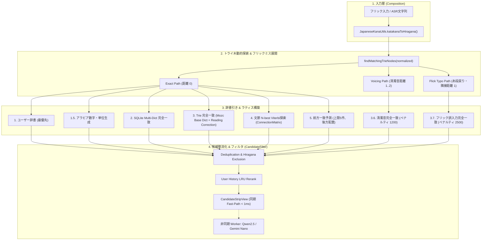

# システムデザインドキュメント: Mozc アルゴリズム統合・フリック補正 & 候補整流化

## 1. 背景と課題

本リポジトリ（JotInput）のかな漢字変換エンジン（`KanaKanjiEngine`）は、Mozc の公式 CRF 連接コスト（`ConnectionMatrix`）および大規模語彙辞書（約13.1万語）の統合により、会話文や連語の変換精度において高い基準（Top-1: 76.0%、MRR: 0.804）を達成しています。

しかしながら、以下の3つの重大な課題が残存していました：
1. **フリック入力における物理的タイプミスへの耐性欠如**:
   - スマホの12キーフリック入力で最も頻出する「フリック認識漏れによるあ段戻り（例: `わたさ` $\to$ `わたし`）」や「隣接12キーの誤タップ（例: `わたき` $\to$ `わたし`）」に対して、一切の補正を行わず平文として扱うため、変換候補が出ないか誤変換となる。
2. **誤読・頻出タイポ辞書の未統合**:
   - Mozc 公式が提供する誤読・ゆらぎ補正辞書（`reading_correction.tsv`、例: `ふいんき` $\to$ `雰囲気`、`いちよう` $\to$ `一応`、`おどさん` $\to$ `お土産`）が取り込まれていない。
3. **`collectPrefixWords`（前方一致予測）の無差別先行挿入による短文節候補の押し出され（`Finding 32`）**:
   - 助詞や短い文節（「いえの」「でません」「でてくる」など）を入力した際、最大80件の前方一致予測候補（「家の外」「家の前」など）が完全一致候補やViterbi候補より上位に割り込み、本来の変換候補が70位以下に沈降する。

---

## 2. アーキテクチャと設計方針

### 全体パイプライン設計

---

## 3. コンポーネント別詳細仕様

### 3.1. 誤読辞書（`reading_correction.tsv`）の統合 (`tools/mozc_dict/build_base_dictionary.py`)
- **データソース**: `tools/mozc/src/data/dictionary_oss/reading_correction.tsv`（757語）
- **変換仕様**:
  - `word`（表記）、`error_reading`（誤読）、`correct_reading`（正読）
  - 正読エントリの品詞 LID / RID を継承。
  - コスト設定: 正読の基本コスト $+ 3000$（誤読として自然に抑制されつつ、正読がない入力時に確実に浮上するバランス）。
  - 例:
    - 正読: `おみやげ	1851	1851	4332	お土産`
    - 誤読補正: `おどさん	1851	1851	7332	お土産`
    - 正読: `ふんいき	1851	1851	3454	雰囲気`
    - 誤読補正: `ふいんき	1851	1851	6454	雰囲気`

### 3.2. フリック入力ミス補正 (`JapaneseKanaUtils.kt` & `KanaKanjiEngine.kt`)
- **12キー幾何・段マッピングテーブルの定義**:
  - **あ段戻り（フリックし損ね・未達）**:
    - `あ` $\to$ `い, う, え, お`
    - `か` $\to$ `き, く, け, こ`
    - `さ` $\to$ `し, す, せ, そ`
    - `た` $\to$ `ち, つ, て, と`
    - `な` $\to$ `に, ぬ, ね, の`
    - `は` $\to$ `ひ, ふ, へ, ほ`
    - `ま` $\to$ `み, む, め, も`
    - `や` $\to$ `ゆ, よ`
    - `ら` $\to$ `り, る, れ, ろ`
    - `わ` $\to$ `を, ん`
  - **12キー隣接タップ（誤爆）**:
    - 例: `さ(3)` の上下左右: `か(2)`, `は(6)`
    - 例: `か(2)` の上下左右: `あ(1)`, `さ(3)`, `な(5)`
- **`findMatchingTrieNodes` 探索仕様**:
  - 探索コスト体系:
    - 完全一致: 距離 $0$
    - 清濁音（か $\leftrightarrow$ が 等）: 距離 $1$（ペナルティ $+1200$）
    - フリックあ段戻り（さ $\leftrightarrow$ し 等）: 距離 $1$（ペナルティ $+2500$）
    - 隣接キー誤爆（さ $\leftrightarrow$ か 等）: 距離 $1$（ペナルティ $+3500$）
  - 枝刈り（Pruning）:
    - 1文字につき展開を許容する最大距離は 1（同時に清濁音とフリックミスが二重発生する経路は探索空間爆発を防ぐため抑制）。
    - ビーム幅上限: 各ステップ最大 24 パスを保持。

### 3.3. 候補整流化（Candidate Ordering & Prefix Demotion）
- **順序の大改革**:
  1. ユーザー辞書一致（最優先）
  2. アラビア数字・単位一致
  3. 完全一致（SQLite ＋ Trie）
  4. 清濁音完全一致
  5. フリックミス完全一致
  6. **複数文節 Viterbi ラティス候補（`searchViterbiLattice`）** $\Leftarrow$ 前方一致より上位に昇格！
  7. **前方一致予測候補（`collectPrefixWords`）** $\Leftarrow$ 上限を従来の 80件から **5件** に制限し、Viterbiの後ろに配置！
- **期待効果**:
  - 「いえの」と打った時、「家の外」「家の前」などの前方一致予測が上位を独占せず、「家の」が堂々1位に表示される。
  - 「でません」と打った時、文節分割・Viterbi候補「出ません」が即座に第1候補に現れる。

---

## 4. 評価計画と成功基準

1. **既存評価スイートの非デグレード保証**:
   - `eval/evaluate_connection_matrix.py`:
     - 会話文50件 Top-1: $\ge 76.0\%$
     - Mozc公式613文: $\ge 41.1\%$
   - 全スポットライト単語（うみのまわりに、いなかだよ、きょうはいいてんき、さぎょうちゅうですので等）の PASS 維持。
2. **フォーカス課題の解決率**:
   - `eval/evaluate_ieno_demasen_proposals.py`:
     - `いえの` $\to$ `家の` (Top-1)
     - `でません` $\to$ `出ません` (Top-1)
     - `でてくる` $\to$ `出てくる` (Top-1)
     - 全体 MRR $\ge 0.520$
3. **新規フリックミス・誤読補正評価**:
   - `わたさ` $\to$ `私 / わたし` が候補上位（Top-3以内）に出現すること。
   - `わたき` $\to$ `私 / わたし` が候補内に出現すること。
   - `ふいんき` $\to$ `雰囲気` が Top-1 に出現すること。
   - `おどさん` $\to$ `お土産` が Top-1 に出現すること。
4. **Android 単体テスト & Dual-Target 回帰**:
   - `./gradlew testDebugUnitTest`: 100% PASS。
   - レイテンシバジェット: 1回のキーストローク処理 $\le 1.0\text{ms}$（UIスレッドを一切ブロックしないこと）。
