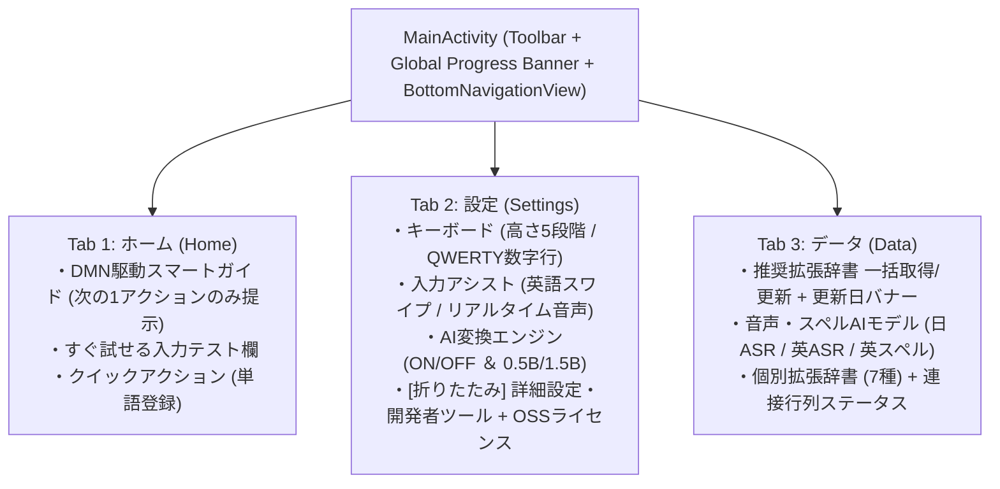

# UI Design & Simplicity Guidelines (UI設計原則とシンプルさ維持ガイドライン v2)

本ドキュメントは、**JotInput** の UI 設計原則（UIガバナンス）を定義します。
v1 では単一縦スクロール画面（`MainActivity`）の肥大化を防ぐために「4カード・ルール」を採用していましたが、JTBD・CUJ に基づく再設計（[`prd_and_design_main_app_ui.md`](docs/prd_and_design_main_app_ui.md)）により、**v2「3タブ情報設計（ホーム / 設定 / データ）＋ DMN スマートガイド」アーキテクチャ** へ発展的に進化させました。

---

## 1. v2 情報設計（3-Tab + DMN Smart Guide Architecture）

---

## 2. UI 設計原則（UI Simplicity Contract v2）

### 原則0: UI変更における PRD (JTBD / CUJ) 作成と DMN / Alloy の積極的活用（必須）
- **PRD 事前策定の義務付け**:
  - UI に関わる変更（レイアウト、画面追加・改修、ナビゲーション、ダイアログ、ユーザー設定、IME キーボード画面等）を行う際は、必ず事前に **PRD（`docs/prd_and_design_*.md`）** を作成・更新すること。
  - ユーザーの利用状況・動機・期待成果を定義する **Jobs to be Done (JTBD)** と、具体的な操作ステップ・例外分岐を明示した **Critical User Journeys (CUJ)** を明確に定義すること。
- **DMN・Alloy の積極的モデリング**:
  - 状態判定、スマートガイドの動的 CTA 選択、機能の有効/無効制御、競合調停など、UI の分岐ロジックや状態遷移を伴う設計では、**DMN（`DecisionTable` / `DecisionModel`）** および **Alloy 形式検証（`.als`）** を積極的に活用すること。
  - 決定表により分岐を Android UI から分離して 100% 単体テスト可能とし、Alloy により到達不能状態や不変条件違反が存在しないことを数学的に検証すること。

### 原則1: 役割に基づく 3 タブ分離と 1 画面あたりの認知負荷最小化
- `MainActivity` は **「ホーム（準備状態・テスト・単語登録）」「設定（日常設定・詳細ツール）」「データ（モデル・辞書管理）」** の 3 タブを維持し、新しいタブを安易に増やさないこと。
- 新しい設定項目やデータ管理機能を追加する場合は、必ず責務に対応するタブへ配置すること。

### 原則2: DMN による宣言的ガイド（「次の1アクション」原則）
- ホーム画面では複数のセットアップ警告や複雑な技術バッジを並立させず、[`MainAppUiDecisionModel`](app/src/main/java/com/example/myasr/context/ime/domain/MainAppUiDecisionModel.kt) の DMN 決定表により、**現時点で最も優先度の高い唯一のアクション（または「準備完了」）** のみを提示すること。
- DMN スマートガイドが担うアクション（例: `入力方法を切り替える`）を、ホーム画面の静的なクイックアクションカード等に重複配置してはならない。

### 原則3: 最適デフォルト優先と詳細設定の段階的開示（Progressive Disclosure）
- コーパス統計や交差検証で最適値が証明できるパラメータ（$\alpha$, $\lambda$ など）はコード内のデフォルト定数として適用し、通常の「設定」領域に露出させないこと。
- ベンチマーク・検証用のノブは「設定」タブ内の **「詳細設定・開発者ツール（デフォルト折りたたみ）」** に格納すること。
- AI 変換エンジンが OFF のときは、エンジン選択ラジオボタン群を `View.GONE` とすること。

### 原則4: モデル・辞書・言語アセットの「データ」タブ一元管理
- 新しいモデル（ONNX / GGUF 等）や辞書を追加する場合、ホームや設定にダウンロードUIを散在させず、必ず **「データ」タブ** に統合し、バックグラウンド進捗は [`ProvisioningForegroundService`](app/src/main/java/com/example/myasr/context/provisioning/infrastructure/ProvisioningForegroundService.kt) 経由のグローバル進捗バナーで可視化すること。

### 原則5: キーボード（IME）画面のミニマリズム維持とユーザー辞書 UI 原則
- [`keyboard_view.xml`](app/src/main/res/layout/keyboard_view.xml) のヘッダーバー（高さ `36dp`）には、**音声トグルボタン**、**候補ストリップ**、**単語登録 (`📖`)**、**クリップボード (`📋`)** 以外の常駐ボタンを追加しないこと。
- ユーザー辞書画面（[`DictionaryActivity`](app/src/main/java/com/example/myasr/DictionaryActivity.kt)）は [`prd_and_design_custom_dictionary_ui.md`](docs/prd_and_design_custom_dictionary_ui.md) に従い、クイック登録＋検索＋ボトムシート分離を維持すること。
- 不要になったレイアウトやリソースは放置せず同コミット内で削除すること（Zero Dead UI Policy）。
