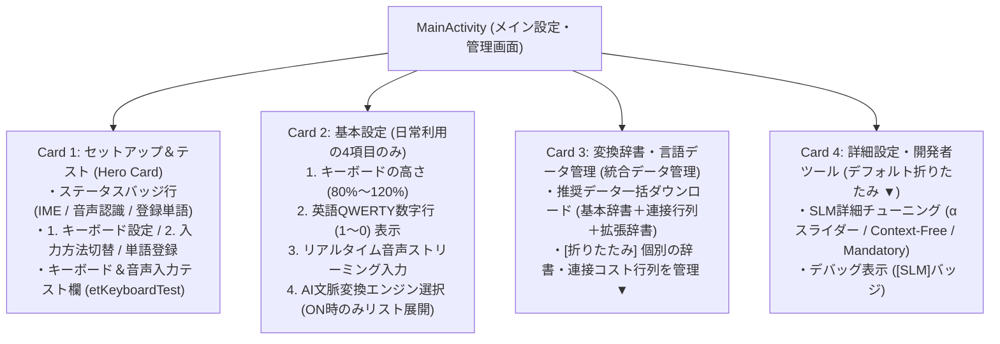

# UI Design & Simplicity Guidelines (UI設計原則とシンプルさ維持ガイドライン)

本ドキュメントは、**JotInput** のUI整理（機能・UIの精査と統合）の設計記録、および**今後新しい機能を追加する際にUIの肥大化・煩雑化を防ぐための厳格な設計原則（UIガバナンス）**を定義します。

---

## 1. 課題背景（なぜUIが煩雑化したのか）

開発初期のプロトタイプ（単体音声認識テスト画面）の上に、システムIME機能、Mozc複数辞書、連接コスト行列、オンデバイスSLMリランキング、複数のSLM推論バックエンド、実験用ハイパーパラメータ（$\alpha$ スライダー、Context-Freeトグル、Mandatoryトグル、デバッグ表示バッジ）が段階的に追加された結果、[`MainActivity`](app/src/main/java/com/example/myasr/MainActivity.kt) が以下の問題を抱えるに至りました：

1. **カードと責務の混在**: 6枚の巨大カードに35個以上のUIコントロールが常時展開され、「日本語変換辞書」カードの中にSLM推論設定やハイパーパラメータが混在していた。
2. **データ管理の分断**: 「基本辞書・拡張辞書」と「連接コスト行列 (`connection_single_column.txt`)」が別々のカードに分断され、一括ダウンロードボタンで連接コスト行列が入らない構造になっていた。
3. **実験・開発者向けパラメータの常時露出**: 交差検証（5-Fold CV）で最適値（$\alpha = 0.00$, Mandatory = ON, Context-Free = ON）が確定した後のチューニング用ノブや単体マイクトレーニング用ハーネスがメイン画面を圧迫していた。
4. **レガシー・未使用リソースの残存**: インプレース編集移行後に不要となった `dialog_edit_dictionary_entry.xml` や旧 `MozcDictionaryDownloader.kt` が残存していた。

---

## 2. 機能とUIの精査・統合アーキテクチャ（4階層構造）

アプリケーションの全機能を精査し、ユーザーの認知負荷を最小化する **4階層・段階的開示（Progressive Disclosure）アーキテクチャ** に再編しました。

### 各セクションの責務と整理結果

| セクション | 常時表示されるUI要素 | 折りたたみ / 自動非表示化された要素 / 削除された要素 |
| :--- | :--- | :--- |
| **Card 1: セットアップ＆テスト** | タイトル、3つのステータスバッジ（IME・音声モデル・単語登録）、IME有効化/切替ボタン、単語登録ボタン、テスト入力欄 (`etKeyboardTest`) | 音声認識モデル未導入時のみ警告バナー (`cardDownload`) を表示（導入済みの場合は非表示） |
| **Card 2: 基本設定** | キーボード高さ（5段階）、QWERTY数字行スイッチ、音声ストリーミングスイッチ、AI文脈変換スイッチ | AI文脈変換がOFFの時はエンジン選択ラジオボタン群 (`layoutRerankEngineSelector`) を自動的に折りたたむ |
| **Card 3: 変換辞書・言語データ管理** | 合計語数バッジ、連接行列バッジ、**「推奨データを一括ダウンロード (辞書＋連接行列)」** ボタン | 個別の拡張辞書（7種）および連接コスト行列の個別再取得・削除UIは `「個別の辞書・連接コスト行列を管理 ▼」` 内にデフォルト格納 |
| **Card 4: 詳細設定・開発者ツール** | カードヘッダー（`「詳細設定・開発者ツール ▼」`）のみ1行表示 | デバッグ表示スイッチ、文頭SLMスイッチ、SLM確定リランクスイッチ、SLM重み係数 $\alpha$ スライダーを内部に格納。旧「単体音声認識テスト」UIは `etKeyboardTest`（IMEキーボードテスト欄）で代替可能なため完全撤去 |

---

## 3. 今後機能を追加する際のUI設計原則（UI Simplicity Contract）

今後新しい機能・モデル・辞書・アルゴリズムを追加する際は、以下の **5大原則** を厳守してください。

### 原則1: トップレベル・カード数の上限（4カード・ルール）
- [`MainActivity`](app/src/main/java/com/example/myasr/MainActivity.kt) のトップレベルカードは原則として以下の **4枚以内** に収めること：
  1. **セットアップ＆テスト (`Hero Card`)**
  2. **基本設定 (`Core Settings`)**
  3. **辞書・モデルデータ管理 (`Unified Data Management`)**
  4. **詳細設定・開発者ツール (`Collapsible Advanced Tools`)**
- 新機能のために新しいトップレベル `MaterialCardView` を追加してはならない。必ず既存の4カードのいずれかに統合すること。

### 原則2: 基本設定（Card 2）への追加基準と「最適デフォルト優先」原則
- **コーパス統計や交差検証（CV）で最適値が証明できるパラメータ（重み係数 $\alpha$、タイムアウト値、閾値など）は、コード内のデフォルト定数として適用し、基本設定UIに露出させないこと。**
- どうしてもベンチマーク比較や検証のためにUIから切り替えたい場合は、必ず **Card 4（`layoutAdvancedContent`：詳細設定・開発者ツール、デフォルト折りたたみ）** の中に配置すること。
- **Card 2（基本設定）** には、一般ユーザーが日常の好みに応じて切り替える項目（最大4〜5項目まで）のみを配置すること。

### 原則3: モデル・辞書・言語アセットの一元管理（One-Tap + Progressive Disclosure）
- 新しい辞書データやモデルファイル（ONNX / GGUF / バイナリ辞書等）を追加する場合、個別のカードを新設してはならない。
- 必ず **Card 3（変換辞書・言語データ管理）** の「一括ダウンロード (`startDownloadAllDicts`)」パイプラインに統合するか、折りたたみセクション（`layoutDictDetailsContainer`）内の個別リストに追加すること。

### 原則4: キーボード（IME）画面のミニマリズム維持
- [`keyboard_view.xml`](app/src/main/res/layout/keyboard_view.xml) のヘッダーバー（高さ `36dp`）には、**音声トグルボタン (`🎙 話す`)**、**候補ストリップ (`CandidateStripView`)**、**単語登録 (`📖`)**、**クリップボード (`📋`：テキスト存在時のみ表示)** 以外の常駐ボタンを追加しないこと。
- キーボード面の高さ・インセット計算（[`KeyboardHeightManager`](app/src/main/java/com/example/myasr/KeyboardHeightManager.kt)）を汚染する装飾ビューやマージンを追加しないこと。

### 原則5: 不要・重複UIの即時撤去（Zero Dead UI Policy）
- トグルスイッチとラジオボタンの重複（例：ON/OFFスイッチの直下に「オフ」選択肢を持つラジオグループを常時表示するなど）を作らないこと。親スイッチがOFFのときは子セレクタを `View.GONE` にすること。
- 仕様変更で不要になったレイアウトXMLやダウンローダークラスは、放置せず同コミット内で削除すること。
- ラベル表記はモバイル画面幅で折り返しが発生しないよう、簡潔な日本語表記（「単語の追加」「辞書に追加」「IME: 有効」等）に統一し、冗長な日英併記や内部実装用語（`mmap`, `connection_single_column.txt` 等）をメインUIに出さないこと。
