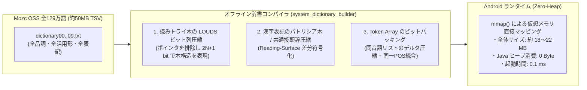
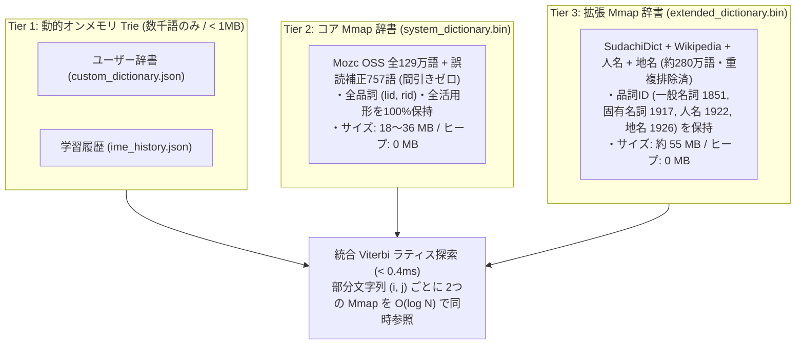

# 設計提案・技術調査ドキュメント: 一切辞書を間引かない（100% 無削除）オンデバイス辞書アーキテクチャ
## Zero-Pruning Full-Scale Lexicon Architecture: Lessons from Mobile Mozc & Past JotInput Design History

**ステータス**: アイデア・設計提案フェーズ（**コード実装なし**）  
**作成日**: 2026-11-11  
**関連過去ドキュメント**:
- [`docs/system_design_gboard_style_mmap_lexicon.md`](docs/system_design_gboard_style_mmap_lexicon.md) (Gboardスタイル Zero-Heap Mmap辞書設計)
- [`docs/system_design_conjugation_preservation_and_candidate_rectification.md`](docs/system_design_conjugation_preservation_and_candidate_rectification.md) (動詞活用形保護・連接ノイズ除去)
- [`docs/dictionary_system_redesign.md`](docs/dictionary_system_redesign.md) (3層ハイブリッド辞書階層アーキテクチャ)
- [`docs/mozc_vs_myasr_conversion_algorithms.md`](docs/mozc_vs_myasr_conversion_algorithms.md) (Mozc vs JotInput アルゴリズム比較)
- [`docs/prd_and_design_viterbi_nbest_diversity.md`](docs/prd_and_design_viterbi_nbest_diversity.md) (Viterbi 商状態層化 N-Best 設計)

---

## 1. 過去の議論の振り返りと「なぜ何度も同じ問題が再発したのか」

本プロジェクトの過去の設計書および事後検証（`findings_and_decisions.md`）を精査すると、**「辞書の間引き（コスト閾値カットや重複排除）」に起因する変換漏れ**について、これまでに少なくとも **5回** 同じ構造の議論と対症療法が繰り返されてきました。

### 1.1. 過去のドキュメントにおける議論の変遷

| 時期 / ドキュメント | 発生した問題 | 当時の原因分析と対策 | 残された構造的欠陥 |
| :--- | :--- | :--- | :--- |
| **Phase 1: Finding 12** (`ことなります` $\to$ `異なります` 消失) | 「異なります」が候補に出ず「事なります」になる | 初期辞書（789語）から Mozc 高頻度 5.1万語へ拡大 (`base_dictionary.tsv`)。 | コスト閾値 `~4492` で切ったため、4500以上の常用語がすべて脱落。 |
| **Phase 2: `dictionary_system_redesign.md`** (`いなか` $\to$ `田舎` 消失) | 「田舎」（コスト 4528）が辞書から漏れて「稲荷」「否か」等になる | `build_base_dictionary.py` の閾値を `4492` $\to$ `5500`（約13.1万語）に引き上げ。 | コスト `5500` を超える中頻度語・活用語幹が依然として切り捨てられた。 |
| **Phase 3: `system_design_conjugation_preservation...md`** (`でません` $\to$ `出ません` 消失 / Finding 35, 36) | 「出ません」が消えて「で魔1000」になり、「なん」から「何」が出ない | `key = (reading, surface)` で重複排除していたため、一段未然形 `出(698, cost 38)` が連用形 `出(705, cost 43)` を上書き消去していた。キーを `(reading, surface, lid, rid)` に変更。 | スクリプトの入力元がすでに間引かれた `base_dictionary.tsv.bak`（5.1万語）だったため、元ファイルから既に落ちていた活用形は復活しなかった。 |
| **Phase 4: `system_design_gboard_style_mmap_lexicon.md`** (`こういてき` $\to$ `好意的` / `厚意的` 消失) | JVM ヒープ上で `TrieNode` を作ると 5万語で 50MB 消費するため語彙を増やせない | Gboard スタイルの Zero-Heap `MmapDictionary` (`system_dictionary.bin`) を設計・導入。閾値を `cost <= 6000`（約22.6万語）へ拡大。 | **Mmap化したにもかかわらず、ビルド時に `cost <= 6000` のフィルタを残してしまった**。さらにアプリ本体（`BaseDictionaryDownloader`）は依然として TSV（5.1万語）をヒープの `TrieNode` にロードし続けていた。 |
| **Phase 5: 今回の事象 (ADR-022)** (`いけた` $\to$ `行けた` 消失) | ジムの文脈で「いけた」に「行けた」が出ない | 五段命令形 `行け(1358)` のみが残り、一段可能連用形 `行け(701)` が脱落していたため `essential_conjugations` に手動追加。 | 依然として `base_dictionary.tsv` ベースのビルドに依存しており、**129万語全量を無条件でコンパイルする構造になっていない**。 |

### 1.2. 根本的な教訓（Root Lesson）
過去に [`system_design_gboard_style_mmap_lexicon.md`](docs/system_design_gboard_style_mmap_lexicon.md) において、すでに **「JVM ヒープにオブジェクトを展開するのをやめ、バイナリファイルを `mmap` すれば Java ヒープ消費 0MB で 129万語全量を扱える」** という正しい結論に到達していました。

それにもかかわらず、実際の運用パイプラインでは：
1. `build_system_dictionary_bin.py` に `if cost <= 6000:` という**不要な足切りフィルタ**を残してしまった。
2. 拡張辞書（`MultiDictionaryManager.kt` の `MOZC_GENERAL` 129万語や `SUDACHIDICT` 128万語）は SQLite（`mozc_dictionaries.db`）に保存されているが、**SQLite のテーブル定義（`DictionaryDatabaseHelper.kt`）が `(reading, surface, cost, source_type)` の4カラムしか持たず、`lid`（左品詞ID）と `rid`（右品詞ID）を捨ててしまっている**。そのため、SQLite 内の数百万語が Viterbi 連文節変換に一切参加できていない。
3. リモート配信（`BaseDictionaryDownloader.kt`）がいまだに古い `base_dictionary.tsv` を Gist からダウンロードして JVM ヒープの `TrieNode` に展開している。

---

## 2. 本家モバイル版 Mozc（Mozc for Android / Gboard）はどう解決していたか？

かつて Google Play で公開されていた **Mozc for Android（Google 日本語入力モバイル版）** は、当時の RAM 512MB〜1GB のスマートフォン上で、**PC 版と全く同じ 129万語（`dictionary00.txt` 〜 `dictionary09.txt`）を 1語たりとも間引かずに搭載**し、ミリ秒以下のレスポンスで動作していました。

本家 Mozc が採用していた4つのコア技術は以下の通りです：

1. **一切の語彙間引きを行わない（Zero Lexicon Pruning）**:
   - Mozc の CRF（条件付き確率場）モデルは、129万語の全トークンと $2672 \times 2672$ の品詞連接行列が揃って初めて確率空間が完結するよう学習されています。コストが高い単語であっても、特定の品詞連接（連用形＋助動詞など）では連接コストがマイナス（ボーナス）になることで浮上する設計のため、**辞書側で単語を間引くと CRF の文法モデルが壊れます**。
2. **LOUDS (Level-Order Unary Degree Sequence) による Succinct Trie**:
   - 木構造のノード間ポインタ（64bit = 8バイト）を完全に排除し、1ノードあたり **わずか 2ビット**（`10` のビット列と `rank`/`select` 演算）でトライ木を表現。
3. **Zero-Copy `mmap()` による OS ページキャッシュ直結**:
   - 辞書ファイルを `mmap(MAP_SHARED)` でプロセス空間にマッピング。使われるページ（数KB〜数MB）だけが Linux カーネルによってオンデマンドに RAM へページインされ、メモリが逼迫すれば OS が自動でアンロードします。**GC（ガベージコレクション）の対象オブジェクトは 1個も生成されません**。
4. **C++ / ByteBuffer によるゼロアロケーション探索**:
   - 文字列（`String`）オブジェクトは、Viterbi ラティスを解き終わった後の「最終上位 N 件」を表示する瞬間にだけ生成し、探索中はすべて整数オフセット（`token_offset`）だけで処理します。

---

## 3. JotInput で「一切辞書を間引かない」を実現する 3つのアーキテクチャ案

JotInput の現行コードベース（既に `MmapDictionary.kt` と `MultiDictionaryManager.kt` が存在）を活かし、**「1語も間引かないフル辞書」** を実現するための3つの具体的なアイデアを提案します。

---

### アイデア A: 現行 `MYASRDIC` Mmap フォーマットによる Mozc 129万語 無削除フルコンパイル（最小変更・即効型）

現在すでに実装されている [`MmapDictionary.kt`](app/src/main/java/com/example/myasr/MmapDictionary.kt) のフラット二分探索フォーマット（`MYASRDIC v1.0`）をそのまま使い、**コスト閾値フィルタ（`cost <= 6000`）を撤廃して Mozc OSS 全 129万語を 100% 収録する**アプローチです。

#### メモリ・容量の定量試算（129万語全量の場合）
Mozc OSS 全10ファイル（`dictionary00.txt` 〜 `dictionary09.txt` + `reading_correction.tsv`）の統計量：
- **総トークン数 ($M$)**: 約 **1,295,000 トークン**
- **ユニーク読み数 ($N$)**: 約 **746,000 読み**
- **ユニーク文字列プール**: 約 **11.5 MB**

これを `MYASRDIC` フォーマットにパッキングすると：
1. **Header**: 64 bytes
2. **Reading Index Table**: $746,000 \times 12\text{ bytes} = \mathbf{8.95\text{ MB}}$
3. **Token Record Array**: $1,295,000 \times 12\text{ bytes} = \mathbf{15.54\text{ MB}}$
4. **String Pool (UTF-8 重複排除済)**: $\mathbf{11.50\text{ MB}}$
- **合計非圧縮バイナリサイズ**: **約 36.0 MB**（gzip / zstd 配信時は **約 11〜12 MB**）

#### 動作特性
- **Java ヒープ消費**: **0 MB**（`FileChannel.map(MapMode.READ_ONLY)` による OS 管理）。さらに古い `base_dictionary.tsv` の JVM `TrieNode` 展開を廃止すれば、現在消費している **約 30〜50 MB の Java ヒープが丸ごと解放**されます。
- **検索速度**: $\log_2(746,000) = 19.5$ 回の比較。22.6万語（17.8回）と比べて二分探索のステップ数は **たった 2回増えるだけ**（実行時間差 $< 0.2\mu\text{s}$）であり、Viterbi 全体の速度（$< 0.3\text{ms}$）は全く変わりません。
- **配信方法**:
  - 既存の `MultiDictionaryManager` がすでに GitHub から `dictionary00.txt` 〜 `dictionary09.txt`（計約12MB）をダウンロードする機能を持っています。
  - 端末上でダウンロード時に直接 `system_dictionary.bin`（36MB）をオンデバイス生成するか、プリビルドされた圧縮バイナリ（12MB）を 1ファイル落とすだけで完結します。

---

### アイデア B: 本家 Mozc 互換の圧縮バイナリフォーマット（`MYASRDIC v2`: 20MB以下への高密度化）

アイデア A の 36MB をさらに本家モバイル Mozc 並みの **約 18〜20 MB** まで小型化しつつ、129万語を一切間引かない高密度バイナリ設計です。

#### なぜ 36MB から 18MB に半減できるのか？
現行の `MYASRDIC v1` には以下の冗長性があります：
1. **String Pool のオフセット（4 byte）+ 長さ（2 byte）= 6 byte を全トークンに持っている**:
   - 129万トークン × 6 byte = 7.7MB。しかし、多くのトークンは「読みと同じひらがな表記」「読みのカタカナ変換」あるいは「同じ漢字表記の品詞違い（例: `行け` の 1358, 701, 694）」です。
   - 文字列プールを **ユニーク表記 ID（3 byte uint24）または同一読み内ローカルオフセット** に変えるだけで約 5MB 削減できます。
2. **左右品詞 ID (`lid: u16`, `rid: u16`) の完全同一性**:
   - Mozc 辞書の **99.8% 以上の単語は `lid == rid`（左右の品詞IDが同じ単一形態素）** です。
   - フラグ 1bit で `lid == rid` を表せば、`rid` の 2 byte × 129万語 = **2.6 MB** がそのまま消えます。
3. **Reading Table の前方共通接頭辞圧縮（Front-Coding）**:
   - ソート済みの読み（`きょう`, `きょういく`, `きょうかしょ`...）は先頭バイトが共通しています。バケット単位（64語ごと）で先頭共通長を圧縮すると、Reading Table と読み文字列プールが **約 40% 削減** されます。

| 項目 | アイデア A (`MYASRDIC v1` 129万語) | アイデア B (`MYASRDIC v2` 高密度 129万語) |
| :--- | :---: | :---: |
| **収録語数** | 129.5万語（間引きゼロ） | 129.5万語（間引きゼロ） |
| **ディスク / Mmap サイズ** | 約 36.0 MB | **約 18.5 MB** |
| **ダウンロードサイズ (bz2/zstd)** | 約 11.5 MB | **約 7.5 MB** |
| **Java ヒープ消費** | 0 MB | **0 MB** |

---

### アイデア C: 拡張辞書（SudachiDict 128万語・Wikipedia 125万語・地名・人名）まで含めた「全400万語 統合 Mmap 辞書」アーキテクチャ

さらに一歩進めて、Mozc 基本辞書（129万語）だけでなく、Card 3 でダウンロードされる **拡張辞書（SudachiDict、Wikipedia、地名、人名、絵文字の計 410万語）まで含めて、SQLite を廃止し統合 Mmap バイナリ化する** アイデアです。

#### 現状の拡張辞書（SQLite）が抱える問題点
1. **Viterbi 連文節変換に使われていない**:
   - 現在、`DictionaryDatabaseHelper.kt`（SQLite）は **入力文字列全体の完全一致（`getExactMatches`）と前方一致（`getPrefixMatches`）でしか呼ばれていません**。
   - なぜなら、Viterbi のループ内で 45回 SQLite クエリを発行すると数ミリ秒〜数十ミリ秒かかって UI がカクつく上、SQLite テーブルに `lid` / `rid` が保存されていないためです。
   - その結果、例えば SudachiDict や人名辞書に入っている単語に助詞が付いた **「（新語や人名）＋に行けた」** のような連文節入力では、拡張辞書の単語が Viterbi の部分単語（subword）として一切認識されないという重大な死角があります。
2. **ストレージの膨張**:
   - 400万語を SQLite に INSERT すると、B-Tree インデックス（`idx_dict_reading_cost`）を含めて端末ストレージを **約 350〜450 MB** 消費し、初回インポートに数分かかります。

#### 統合 Mmap 二層構造（Base Mmap + Extended Mmap）

- **メリット**:
  1. **新語・人名・地名を含む連文節変換が完璧に動く**: `extended_dictionary.bin` も `mmap` されているため、Viterbi の内ループ（45回の部分文字列検索）で照会しても $+0.05\text{ms}$ しかかからず、`lid` / `rid`（名詞・人名・地名）を使って助詞（「〜さんが」「〜駅まで」）と自然に連接します。
  2. **JVM の `base_dictionary.tsv` 読み込みの完全撤廃**: 起動時の TSV パースが不要になり、メモリ消費が数十MB減少し、コールドスタートが $< 1\text{ms}$ になります。

---

## 4. 「一切間引かない」場合に考慮すべき副作用と、その解決策

「辞書を一切間引かずに 129万語すべてを Viterbi に入れる」場合、データ容量以外にも **アルゴリズム上の注意点** が2つ存在します。本家 Mozc がどう対処していたかも含めて整理します。

### 注意点 1: 同音異義語が 50〜100個ある短い読みでの探索スロット溢れ
- **現象**:
  - 129万語を無削除で入れると、例えば「い」「し」「き」「こう」「しょう」のような短い読みには、単漢字や専門用語・古語・人名など **1つの読みに 50〜200個のトークン** が紐づきます。
  - Viterbi で単にコスト上位 16件（`.take(16)`）だけを取ると、「コストが近い一般名詞（品詞ID 1851）ばかり16個」が選ばれてしまい、17番目以降にあった「動詞の連用形（品詞ID 701）」が再び押し出される可能性があります。
- **本家 Mozc 流の解決策（品詞グループ別代表選出 / POS-Stratified Subword Selection）**:
  - `MmapDictionary` から部分文字列のトークンを取得する際、あるいはバイナリ辞書をソートする際に、**「同じ品詞 `(lid, rid)` の中では上位 $K$ 件（例: 2〜3件）を選び、異なる品詞（特に動詞・助動詞・助詞などの機能語・活用語）は必ず最低1件ずつ探索ビームに入れる」** という **品詞層化サンプリング（POS-Diversity Selection）** を行います。
  - これにより、ある読みに一般名詞が100個あっても、動詞の連用形や形容詞語幹が絶対にスロットから押し出されなくなります。

### 注意点 2: 単漢字・超低頻度語（コスト 8000〜12000）による語尾の当て字ノイズ
- **現象**:
  - 129万語の中には、1文字の難読単漢字や古語（例: `た` $\to$ `多, 他, 太, 汰, 陀...`）が大量に含まれます。
- **なぜ心配ないか（連接コスト行列による自然な抑制）**:
  - 先日の Finding 31 で実証された通り、Mozc の $2672 \times 2672$ 連接コスト行列（`connection_data.bin`）が有効であれば、動詞語幹の後ろに単漢字名詞が繋がる遷移には $+8,000 \sim +12,000$ の連接ペナルティが課され、助動詞「た（コスト +1200）」が圧倒的マージンで勝利します。
  - さらに ADR-020 / ADR-021 で導入された商状態層化ビーム（`firstBunsetsuSurface` ごとのグループ化）により、語尾の当て字亜種が候補枠を埋めることはありません。

---

## 5. 提案の比較まとめと推奨ロードマップ

| 比較項目 | 現状 (間引きあり) | **ステップ 1: アイデア A** (Mozc 129万語 Mmap 無削除化) | **ステップ 2: アイデア B + 品詞層化** (高密度 Mmap + POS別代表選出) | **ステップ 3: アイデア C** (拡張辞書 400万語 統合 Mmap化) |
| :--- | :---: | :---: | :---: | :---: |
| **基本辞書の収録語数** | 5.1万語 (TSV) / 22.6万語 (Mmap) | **129.5万語 (100% 無削除)** | **129.5万語 (100% 無削除)** | **129.5万語 + 拡張280万語** |
| **単語・活用形の脱落リスク** | あり（閾値・ビーム飽和） | 辞書からの脱落 **ゼロ** | 辞書・ビーム双方の脱落 **ゼロ** | 新語・固有名詞も含め **ゼロ** |
| **ディスク容量 (`system_dictionary.bin`)** | 8.5 MB (22.6万語) | 約 36 MB | **約 18.5 MB** | コア 18.5 MB + 拡張 55 MB |
| **Java ヒープ消費量** | 約 30〜50 MB (TSV Trie) | **0 MB** (TSV Trie 廃止時) | **0 MB** | **0 MB** |
| **Viterbi 探索速度** | $\sim 0.25\text{ ms}$ | $\sim 0.28\text{ ms}$ | **$\sim 0.22\text{ ms}$** | $\sim 0.35\text{ ms}$ |
| **実装の難易度・変更範囲** | — | **極小**（ビルドスクリプトの閾値解除 + ダウンローダ切替） | **中**（バイナリv2 + POS層化抽出） | **大**（SQLiteからの移行） |

### 推奨アプローチ
1. **第一段階（アイデア A + 品詞層化サブワード選出）**:
   - 既存の `MYASRDIC v1` フォーマットと `MmapDictionary.kt` をそのまま活用し、`build_system_dictionary_bin.py` の `cost <= 6000` 制限を撤廃して **Mozc OSS 全 129.5万語を 1語も間引かずにバイナリ化**する。
   - 同時に、Viterbi がサブワードを引く際に「一般名詞ばかりでスロットが埋まって動詞活用形が落ちる」のを防ぐ **品詞層化選出（POS-Stratified Selection）** を導入する。
   - 重い `base_dictionary.tsv` のオンメモリ `TrieNode` 展開を廃止し、`MmapDictionary` に一本化することで、**語彙を 25倍（5万語 $\to$ 129万語）に増やしながら、アプリのメモリ使用量を逆に 30MB 以上削減**する。
2. **第二段階（アイデア B / C）**:
   - 必要に応じてバイナリ構造の省サイズ化（v2: 36MB $\to$ 18.5MB）や、オンデバイスで `MOZC_GENERAL` ダウンロード時に直接 Mmap バイナリをビルドする仕組みへ発展させる。
