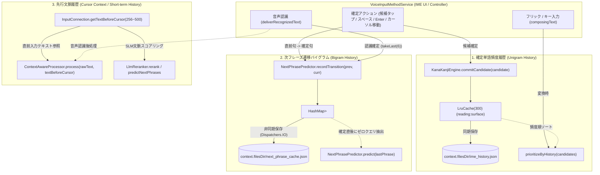

# ユーザー入力履歴の活用アーキテクチャ仕様書

## 1. 概要 (Executive Summary)

本ドキュメントは、JotInput（オンデバイス音声入力・フリックハイブリッドIME）における**ユーザーの入力・確定履歴（User Input History）が現在どのように記録・保存・利用されているか**を、コードベースおよび設計ドキュメントに基づき体系的にまとめた技術仕様書です。

JotInputにおいて、ユーザーの入力履歴は以下の**3つの主要レイヤー**に分類されて有機的に機能しています。

1. **確定単語頻度履歴（Unigram Selection History Cache）**
   - 目的: 読みに対する過去の確定候補の優先昇格（かな漢字変換順位のパーソナライズ）
   - 管理クラス: [`KanaKanjiEngine.kt`](app/src/main/java/com/example/myasr/KanaKanjiEngine.kt)
   - 保存先: `context.filesDir/ime_history.json`（最大300件のLRUキャッシュ）
2. **フレーズ遷移バイグラム学習履歴（User Bigram Learning Cache）**
   - 目的: フレーズ確定直後（キー入力前、Zero-query）の次フレーズ予測（Next-phrase Continuation Prediction）
   - 管理クラス: [`NextPhrasePredictor.kt`](app/src/main/java/com/example/myasr/NextPhrasePredictor.kt)
   - 保存先: `context.filesDir/next_phrase_cache.json`（最大1000親エントリ）
3. **エディタ先行文脈履歴（Preceding Cursor Context / textBeforeCursor）**
   - 目的: 音声認識テキストの同音異義語・人名・異体字補正、およびSLM（小規模言語モデル）推論リランキング
   - 管理クラス: [`ContextAwareProcessor.kt`](app/src/main/java/com/example/myasr/ContextAwareProcessor.kt), [`LlmReranker.kt`](app/src/main/java/com/example/myasr/LlmReranker.kt)
   - 取得元: Android `InputConnection.getTextBeforeCursor()`

---

## 2. 全体アーキテクチャ図 (Input History Lifecycle)

---

## 3. 各履歴レイヤーの詳細仕様

### 3.1. 確定単語頻度履歴（Unigram Selection History）

- **実装ファイル**: [`KanaKanjiEngine.kt`](app/src/main/java/com/example/myasr/KanaKanjiEngine.kt)
- **記録タイミング**:
  - `CandidateStripView` で候補をタップした時
  - スペースキー（`onSpacePressed`）で先頭変換候補を確定した時
- **キーと値の形式**:
  - キー: `"${candidate.reading}:${candidate.surface}"`（例: `"とうきょう:東京"`, `"きしゃ:貴社"`）
  - 値: 確定カウント（Int）
- **利用箇所とアルゴリズム**:
  1. **完全一致辞書候補の順位補正**:
     - Trie内の同一読み候補をソートする際、`historyCache` のカウント降順を最優先し、同カウント時はコスト順で比較。
  2. **濁音・半濁音揺らぎ候補の順位補正**:
     - 「かいき」と打った際の「会議（かいぎ）」などの候補も、過去に確定した履歴があれば上位に浮上。
  3. **前方一致（サジェスト）および全候補の最終ソート**:
     - `prioritizeByHistory()` メソッドで、ユーザー辞書（`source == "user"`）以外の全候補を過去の確定回数が多い順にソート。
- **永続化とメモリ保護**:
  - 最大容量: 300エントリの Android `LruCache`。
  - ファイル: `ime_history.json`（JSON形式）。初期化時に全件ロード、確定のたびにファイルへ同期書き込み。

### 3.2. フレーズ遷移バイグラム学習履歴（User Bigram Learning Cache）

- **実装ファイル**: [`NextPhrasePredictor.kt`](app/src/main/java/com/example/myasr/NextPhrasePredictor.kt)
- **記録タイミング**:
  - 連続してフレーズが確定された時（`previousCommittedPhrase` $\to$ `currentCommittedPhrase`）。
  - 音声入力確定時、直前の確定フレーズと新しく確定された音声認識テキスト（末尾句）の間で遷移を記録。
- **データ構造**:
  - `HashMap<String, MutableMap<String, Int>>`（`前フレーズ` $\to$ `[後続フレーズ: 選択回数]`）
  - 例: `"お疲れ様"` $\to$ `{"です": 14, "でした": 5}`
- **利用箇所とアルゴリズム**:
  - ユーザーがフレーズを確定した直後（次のキーを入力する前の Zero-query 状態）、`showNextPhrasePredictions(committed)` が呼び出される。
  - **Fast-Path（$< 0.1\text{ms}$、メインスレッド）**:
    - `nextPhrasePredictor.predict(lastPhrase)` により、`bigramHistory[cleanLast]` から頻度降順で候補を即座に抽出し、`source = "history_bigram"` として `CandidateStripView` に最優先表示。
  - **Slow-Path（非同期SLM生成とマージ）**:
    - バックグラウンドでSLM（Qwen 1.5B等）が文脈から生成した先読み候補（`slmContinuations`）とマージする際も、**ユーザー履歴バイグラム候補を第1優先（Priority 1）として先頭に保持**。
- **永続化とスレッド安全性**:
  - 最大容量: 1000親キー（超過時は古いキーを削除）。
  - ファイル: `next_phrase_cache.json`。
  - 書込方式: UI描画のジッター（カクつき）を完全排除するため、`CoroutineScope(Dispatchers.IO)` による**非同期JSONバックグラウンド書き出し**を実施。

### 3.3. 先行文脈履歴（Preceding Cursor Context / Short-term History）

- **実装ファイル**: [`ContextAwareProcessor.kt`](app/src/main/java/com/example/myasr/ContextAwareProcessor.kt), [`LlmReranker.kt`](app/src/main/java/com/example/myasr/LlmReranker.kt)
- **取得メカニズム**:
  - `InputConnection.getTextBeforeCursor(256 ~ 500, 0)` を呼び出し、直前にエディタに入力された文字列を抽出。
- **利用箇所**:
  1. **音声認識の文脈依存同音異義語・異体字補正 ([`ContextAwareProcessor.kt`](app/src/main/java/com/example/myasr/ContextAwareProcessor.kt))**:
     - **異体字（外字）補正**: 先行文脈に「渡邊」「齊藤」等がある場合、音声認識が一般的な「渡辺」「斉藤」と出力しても先行文脈の異体字に自動統一。
     - **意味的同音異義語補正**: 先行文脈内のキーワード（「新聞」「記事」 $\to$ 「記者」、「お世話」「御中」 $\to$ 「貴社」、「出張」「戻り」 $\to$ 「帰社」など）に基づき、音声認識結果を適切に置換。
     - **人名・専門用語補正**: 先行文脈に登場した名前や英単語（例: `GraphQL`）に合わせて音声認識誤りを修正。
  2. **SLM（小規模言語モデル）推論リランキング ([`LlmReranker.kt`](app/src/main/java/com/example/myasr/LlmReranker.kt))**:
     - `textBeforeCursor` をプレフィックス文脈としてSLMに入力し、変換候補を接続したときの因果対数尤度（Causal Log-Likelihood / Perplexity）を算出。文脈に最も自然な候補を先頭へ昇格。

### 3.4. 1文字アンドゥ履歴（Immediate Commit Undo State）

- **実装ファイル**: [`VoiceInputMethodService.kt`](app/src/main/java/com/example/myasr/VoiceInputMethodService.kt#L61-L62, #L450-L455)
- **状態変数**: `lastCommittedReading` および `lastCommittedSurface`
- **利用目的**:
  - 直前の確定を取り消す「アンドゥ（Backspace復元）」機能。
  - 確定直後（未変換バッファが空の時）にBackspaceキーが押された場合、`deleteSurroundingText(lastCommittedSurface.length, 0)` で確定文字を削除し、`composingText.append(lastCommittedReading)` で元の未確定状態に戻す。

---

## 4. 既存仕様・ポリシーとの対比

| 観点 | 現在の実装仕様 | 設計ポリシー / 規約との整合性 |
| :--- | :--- | :--- |
| **プライバシー・端末完結性** | 全ての履歴キャッシュ（`ime_history.json`, `next_phrase_cache.json`）は端末内アプリローカルストレージ（`context.filesDir`）にのみ保存。ネットワーク送信は一切行わない。 | 規約完全準拠（完全オフライン・オンデバイス志向）。 |
| **レイテンシ設計** | 候補探索や次フレーズ表示の初回描画はオンメモリ履歴からミリ秒未満（$< 0.1\text{ms}$）で即時反映。ファイル保存は非同期IOまたは軽量JSON同期書き込み。 | 規約完全準拠（「Latency & Pause-Free Commit Budget」）。 |
| **コスト調整方針** | 履歴は選択回数カウント（頻度）によるソート優先度補正としてのみ適用。Mozc辞書の語彙コストやCRF接続コストをアドホックに書き換えることはない。 | 規約完全準拠（「Anti-Anecdotal Tuning Policy: コストハッキングの禁止」）。 |
| **カスタム辞書との分離** | ユーザー辞書（`custom_dictionary.json`）とは別ファイル・別ライフサイクルで管理されており、辞書更新や再構築で履歴が壊れない。 | 規約完全準拠（「Custom Dictionary Persistence Contract」）。 |

---

## 5. 今後の拡張・改善余地 (Future Recommendations)

1. **時間減衰（LRU / 時間重み付けスコア）の導入**:
   - 現在の単語確定履歴は単純なカウント加算（`count + 1`）であり、大昔に頻繁に使った単語が長期間上位に残る傾向がある。指数時間減衰（例: Half-life 7 days）を導入することで、直近の話題や作業傾向への適応力を向上可能。
2. **音声入力確定のバイグラム精度向上**:
   - 現在の音声入力では末尾6文字（`text.takeLast(6)`）を `previousCommittedPhrase` としているが、形態素境界（文節末尾）を考慮したフレーズ分割を行うことで、次フレーズ予測の接続精度をさらに高めることが可能。
3. **履歴クリア・プライバシー管理UIの提供**:
   - `NextPhrasePredictor.clearHistory()` 等のAPIは用意されているため、設定画面（MainActivity / DictionaryActivity）から学習履歴の一括消去やエクスポートができるUI導線の追加が望ましい。
