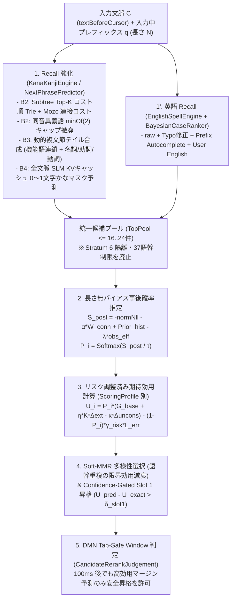

# 効用スコア（Utility Score）導入による予測変換最適化 デザインドキュメント＆総合評価プラン

- **ステータス**: **Phase 1 (B1 + B2 + B5 + DMN/Alloy) 実装・検証完了 / Phase 2 準備中**
- **上位仕様**: [JotInput トップレベル PRD (`docs/prd_top_level.md`)](prd_top_level.md)
- **関連ドキュメント**:
  - [EIS-v1 ベースラインレポート (`docs/eis_baseline_report.md`)](eis_baseline_report.md)
  - [フリック入力 100件ヘッドルーム解剖と予測変換 6大ブレークスルー (`docs/eis_radical_headroom_and_moonshot_concepts.md`)](eis_radical_headroom_and_moonshot_concepts.md)
  - [日本語フリック入力 100件ヘッドルーム評価レポート (`docs/flick_input_100_headroom_evaluation_report.md`)](flick_input_100_headroom_evaluation_report.md)
- **主対象**: 日本語フリック入力 (`CUJ-2` / `CUJ-3` フリック) の大幅高速化、および **英語入力 (`CUJ-4`)・音声入力 (`CUJ-1`) を含む総合トップラインメトリック (`Global EIS`) の同時最適化と非回帰保証**

---

## 1. エグゼクティブ・サマリー：なぜ「NLL 最小化」から「期待 EIS 効用最大化」へ転換するのか

JotInput のプロダクト全体のトップラインメトリック（North Star Metric）は、ユーザーが単位時間あたりに意図通りのテキストをどれだけ多く確定できるかを表す **EIS（Effective Intended-text Speed, 文字/分）** です：
$$\text{EIS} = \left( \sum_{c \in \{\text{CUJ-1..4}\}} \frac{w_c}{\text{EIS}_c} \right)^{-1}, \quad w = (0.40, 0.35, 0.15, 0.10)$$

現在の候補ランキングエンジン（[`LlmReranker.scoreAndRankPool`](app/src/main/java/com/example/myasr/context/reranking/infrastructure/LlmReranker.kt#L77-L430)）は、**「条件付き負の対数尤度（NLL）＋ ヒューリスティックな各種ペナルティの最小化」** を目的関数としています。しかし、100 件のフリックヘッドルームデータ（[`eval/flick_headroom_dataset_100.json`](eval/flick_headroom_dataset_100.json)）および現行コードベースを精査した結果、**「NLL の最小化」と「トップラインメトリック EIS の最大化」は構造的に一致しない** ことが判明しました。

- **NLL 最小化の罠**: 1 トークンの短い確定語（`詐欺`、`向か`、`医`）は累積 NLL が小さく、長い予測候補（`作業中ですので`、`電車に乗る`、`移動`）はトークン数に比例して累積 NLL が大きくなります。さらに現行コードでは `lambdaExt * deltaExt` の追加罰則と Stratum 6 隔離が重なり、**ユーザーの打鍵数を 8 割削減できる正解予測候補を自ら画面外へ追放** しています。
- **効用スコア（Risk-Adjusted Expected EIS Utility）の提案**:
  候補 $W_i$ を順位 $r_i$ に提示したときに得られる **「リスク調整済みの期待節約時間（Expected Time Saved）」** を効用スコア $U(W_i \mid C, q)$ として直接定式化し、すべての既存アルゴリズムを **「$U$ の最大化」という単一の統一目的関数** に統合・再編します。
- **クロスカッティング配慮**:
  `LlmReranker.scoreAndRankPool` は日本語フリックだけでなく **英語 QWERTY タイポ修正・オートコンプリート (`CUJ-4`)** でも共用されています。本設計では、英語・日本語それぞれに KLM 定数（$K_f = 0.40\text{s}$ vs $K_q = 0.30\text{s}$）と誤変換リスクペナルティをパラメータ化した `ScoringProfile` を導入し、**フリック入力の劇的改善（100件ヘッドルーム `95.5` $\to$ `388.8 cpm`、公式 CUJ-2 `173.6` $\to$ `294.8 cpm`）** と **英語・音声を含む総合 Global EIS（`187.0` $\to$ `221.4+ cpm`）の無回帰・同時向上** を両立します。

---

## 2. 現行アルゴリズム群の徹底精査（Inventory & Audit）

これまでに多数のアルゴリズムが段階的に追加された結果、候補生成・リランキング・UI 保護の責務が複数ファイルに分散し、一部が互いに打ち消し合っています。実装に先立ち、既存の 7 大コンポーネントを精査・仕分けします。

| # | 現行コンポーネント・アルゴリズム | 該当箇所 | 現在の役割と挙動 | 精査判定（効用最大化に向けた処置） |
| :-: | :--- | :--- | :--- | :--- |
| **1** | **Span-Aware Bayesian Scoring (`scoreAndRankPool`)** | [`LlmReranker.kt:77-250`](app/src/main/java/com/example/myasr/context/reranking/infrastructure/LlmReranker.kt#L77-L250) | `rawNll` に加え、`deltaUnconsumed > 0`（部分一致）へ `muSpan + kappaCommit`、`deltaExt > 0`（予測）へ **`lambdaExt = 1.20f * deltaExt`** を加算。日・英共通で動作。 | **【再設計・中核化】** ・`lambdaExt * deltaExt` の線形罰則を**撤廃**。 ・トークン長正規化サプライザルから事後確率 $P(W_i \mid C, q)$ を算出し、**期待節約時間効用 $U$** に置換する。 |
| **2** | **Adaptive Stratified Interleaving (`Stratum 0..6`)** | [`LlmReranker.kt:252-429`](app/src/main/java/com/example/myasr/context/reranking/infrastructure/LlmReranker.kt#L252-L429) | 候補を `exactUser / full / prefix / ext` に分離し、予測候補 (`extIndices`) を **Stratum 6（最下層）** に隔離。昇格も `-0.50f` 勝利条件でほぼ不可能。 | **【廃止・統合】** ・Stratum 6 隔離を**廃止**。 ・統一プールで効用 $U$ に基づき順位決定し、安全なマージン条件を満たす予測候補の Slot 1 昇格を許可する。 |
| **3** | **2D-MMR 多様性制御 & Det-Sub Prevention** | [`LlmReranker.kt:267-353`](app/src/main/java/com/example/myasr/context/reranking/infrastructure/LlmReranker.kt#L267-L353) | `firstBunsetsuSurface` / `lastContentWordSurface` の重複に `divPenalty`（2.00f / 1.60f）を課し、上位フル候補に包含される部分語を抑制。 | **【維持・効用枠組みへ統合】** ・同じ語幹の重複候補で候補バーが埋まるのを防ぐため有効。効用スコア上の **Soft Marginal Utility Decay** として統一プールに適用する。 |
| **4** | **Hybrid-6b History × SLM Fusion & User Clamping** | [`LlmReranker.kt:172-238`](app/src/main/java/com/example/myasr/context/reranking/infrastructure/LlmReranker.kt#L172-L238) | `historyCount`、`lastUsedAtMs` の時間減衰、Coherence Gate (`thetaGate`)、`isExactUser` クランピング（`sysBestNll - gammaUser * priority`）。 | **【維持・Prior 統合】** ・個人最適化として高精度。効用モデル内では事後確率 $P(W_i \mid C, q)$ を押し上げる **Personal Prior（事前確率ブースト）** としてそのまま活用する。 |
| **5** | **`collectPrefixWords` & Section 5.5 予測補完** | [`KanaKanjiEngine.kt:812-952`](app/src/main/java/com/example/myasr/context/kanakanji/domain/KanaKanjiEngine.kt#L812-L952), [`L1147-1171`](app/src/main/java/com/example/myasr/context/kanakanji/domain/KanaKanjiEngine.kt#L1147-L1171) | ・盲目的な 80 件 BFS 打ち切り＋同音語 `minOf(2)` キャップ。 ・Section 5.5 は 37 語幹ハードコード。 ・`interleavePredictiveCandidates` が Slot 1 を必ず現行入力長候補に固定。 | **【抜本刷新】** ・**Subtree Top-K コスト順 Trie**＋Mozc 連接コスト一次選別＋同音キャップ撤廃（B2）。 ・**動的複文節テイル合成**（Mozc 機能語連鎖＋名詞+助詞+動詞ロールアウト）で 37 語幹制限を撤廃（B3）。 ・Slot 1 固定は効用ベース判定へ移管（B5）。 |
| **6** | **`NextPhrasePredictor` (ゼロクエリ予測)** | [`NextPhrasePredictor.kt:195-218`](app/src/main/java/com/example/myasr/context/kanakanji/domain/NextPhrasePredictor.kt#L195-L218), [`VoiceInputMethodService.kt:1400`](app/src/main/java/com/example/myasr/VoiceInputMethodService.kt#L1400) | ・`extractLastWordOrParticle` が末尾 1 語以外を破棄。 ・`predictNextPhrases(maxTokens = 2)` が 2 トークンで打ち切り。 | **【拡張】** ・全文脈 SLM KV キャッシュと連動し、0〜1 文字時点で連語・動詞句（`捺印する`, `原因を究明する` 等）を生成できるよう `maxTokens` とかなマスクを拡張（B4）。 |
| **7** | **DMN 判定 (`CandidateRerankJudgement`) & 英語呼び出し経路** | [`CandidateRerankJudgement.kt`](app/src/main/java/com/example/myasr/context/reranking/domain/CandidateRerankJudgement.kt), [`VoiceInputMethodService.kt:1459-1650`](app/src/main/java/com/example/myasr/VoiceInputMethodService.kt#L1459-L1650) | ・`TapSafeOrdering` は 100ms 経過後の Top-1 変更を禁止（`partial -> full` のみ許可）。 ・英語タイポ/補完も `rerankWithStatus` (`scoreAndRankPool`) を呼び出し。 | **【整合・拡張】** ・`TapSafeOrdering` に「安全マージンを満たす高効用予測候補の Slot 1 昇格」ルールを追加（Alloy 検証と同期）。 ・英語プール用に `EN_QWERTY` 効用プロファイルを設定。 |

### 精査から得られた最重要の教訓
1. **アルゴリズム同士がケンカしている**:
   `KanaKanjiEngine` が予測候補を生成し `interleavePredictiveCandidates` で Slot 2 に並べても、続く `LlmReranker.scoreAndRankPool` が `lambdaExt` で罰し Stratum 6 へ落とし、`TapSafeOrdering` が 100ms 後の昇格をブロックするという **三重の抑制構造** になっていました。
2. **「候補プールに入らない」問題と「順位が上がらない」問題の分離**:
   効用スコア $U$ は **Precision（どの候補を Slot 1 に置くか）** を完璧に解決しますが、そもそも `collectPrefixWords` の 80 件打ち切りや単一形態素 Trie のせいで正解がプールに存在しない場合は無力です。したがって、**Recall 改善（B2/B3/B4/B6）と効用ベースランキング（B1/B5）は必ずセットで設計** する必要があります。

---

## 3. トップラインメトリック (EIS) 直結「リスク調整済み・期待効用スコア」の数理設計

### 3.1 KLM-v1 時間モデルからの厳密な導出

[`eval/eis/klm.py`](eval/eis/klm.py) において、入力 1 件あたりの所要時間 $T$ は以下で定義されています：
$$T = T_{\text{type}}(N) + T_{\text{select}}(r) + T_{\text{correct}}(\text{error})$$
- $N$: ユーザーが実際に行った打鍵数（キー単価 $K \in \{K_f = 0.40\text{s}, K_q = 0.30\text{s}\}$）
- $r$: 正解候補の順位（1-based: Slot 1 = $0.40\text{s}$, Slot 2 = $0.70\text{s}$, Slot $r \le 5$ = $0.40 + 0.30(r-1)$）
- 誤選択（ユーザーが誤った候補をタップしてしまい、削除・再入力する場合）の KLM 訂正ペナルティ：
  $$L_{\text{err}}(W_i) = L_{\text{loc}} + D \cdot \text{len}(W_i) + K \cdot \text{keys}(W_i) + C_2 \quad (L_{\text{loc}} = 1.5\text{s},\; D = 0.20\text{s})$$

ユーザーが長さ $N$ の入力を行った時点で、候補 $W_i$（読み/綴り長 $M_i$）を選択した場合に**節約できる時間 $G(W_i, N)$**（完全一致または予測補完により入力をスキップできた残り時間）は、追加打鍵の省略分 $\Delta_{\text{ext}}(W_i) = \max(0, M_i - N)$ に比例します：
$$G(W_i, N) = G_{\text{base}}(W_i) + K \cdot \Delta_{\text{ext}}(W_i)$$
ここで $G_{\text{base}}(W_i)$ は「その候補が現在の入力意図を満たす基本価値（未消費ペナルティ $\Delta_{\text{unconsumed}} = \max(0, N - M_i)$ がある部分一致は未完了のため割り引かれる）」を表します。

### 3.2 事後確率 $P(W_i \mid C, q)$ の長さ無バイアス推定

長い予測候補が不当に低い確率にならないよう、候補 $W_i$ の生 NLL から **「トークン長正規化サプライザル」** と **「Mozc 連接・辞書コスト」**・**「履歴 Prior」** を統合した対数事後スコア $S_{\text{post}}(W_i \mid C, q)$ を定義します：

$$S_{\text{post}}(W_i \mid C, q) = -\bar{\mathcal{L}}_{\text{norm}}(W_i \mid C) - \alpha_{\text{conn}} W_{\text{conn}}(\text{rid}(C), \text{lid}(W_i)) + \text{Prior}_{\text{hist/user}}(W_i) - \lambda_{\text{obs}} \cdot \text{obsPenalty}_{\text{eff}}(W_i)$$

ここで：
- **トークン長正規化サプライザル**:
  $$\bar{\mathcal{L}}_{\text{norm}}(W_i \mid C) = \frac{\text{rawNll}(W_i \mid C)}{\max(1, \text{tokens}(W_i))^{\rho}} \quad (\rho \in [0.7, 1.0]\text{：dev分割で較正})$$
  ※ $\rho = 0$ が従来の非正規化和、$\rho = 1.0$ が完全 1 トークン平均。$\rho \approx 0.85$ 付近により、長い複文節の不当な累積ペナルティを解消しつつ、過剰な長文膨張を防ぎます。
- **文脈尤度ゲート付き観測ペナルティ (`obsPenalty_eff`)**:
  濁音・半濁音・小書き省略やフリック隣接タイポがある場合でも、SLM が文脈上極めて自然であると判定した場合（$\Delta\bar{\mathcal{L}}$ が閾値内）はペナルティを減衰させます（B6）。
- **候補プール内での事後確率 $P_i$**:
  $$P_i = P(W_i \mid C, q) = \frac{\exp(\tau^{-1} S_{\text{post}}(W_i \mid C, q))}{\sum_{j \in \text{Pool}} \exp(\tau^{-1} S_{\text{post}}(W_j \mid C, q))}$$

### 3.3 リスク調整済み・期待効用スコア $U(W_i \mid C, q)$ の定義

候補 $W_i$ の **期待節約時間効用（秒単位の期待利得）** を次式で定義します：

$$\boxed{U(W_i \mid C, q) = P_i \cdot \Big( G_{\text{base}}(W_i) + \eta_{\text{ext}} \cdot K \cdot \Delta_{\text{ext}}(W_i) - \kappa_{\text{uncons}} \cdot \Delta_{\text{unconsumed}}(W_i) \Big) - (1 - P_i) \cdot \gamma_{\text{risk}} \cdot L_{\text{err}}(W_i)}$$

#### この数式がなぜトップラインメトリック (EIS) を直接最大化するのか（4つの性質）
1. **確信度が高い予測候補ほど劇的に優遇される**:
   `作業中ですので`（$P_i \approx 0.90$, $\Delta_{\text{ext}} = 7$）なら、$\eta_{\text{ext}} K_f \Delta_{\text{ext}} \approx +2.8\text{s}$ の節約利得が効用 $U$ を押し上げ、2文字の誤変換候補（`詐欺`, $P_j \approx 0.05$）を圧倒して **Slot 1** を獲得します。
2. **「当てずっぽうの長大予測」に対する自然なブレーキ**:
   確率 $P_i$ が低い（例：$P_i = 0.25$）のに文字数だけ長い予測候補は、第 2 項の誤選択損失 $(1 - P_i) \cdot \gamma_{\text{risk}} \cdot L_{\text{err}}(W_i)$ が大きくなり、**期待効用 $U$ が自動的にマイナスになる** ため、ノイズ候補が Slot 1 を荒らす事故（英語での誤補完・日本語での誤予測）を防ぎます。
3. **不完全な部分一致（`unconsumedDeltas > 0`）の適切な抑制**:
   入力 $N$ 文字の一部しか消費しない候補には $-\kappa_{\text{uncons}} \cdot \Delta_{\text{unconsumed}}$ が効き、完全消費または予測完了候補が優先されます。
4. **日・英共通の数理構造とモード別プロファイル (`ScoringProfile`)**:
   単一の式で、入力モードに応じた定数セットを切り替えるだけで日英双方に最適化できます：

| パラメータ | `JA_FLICK` (日本語フリック) | `JA_ZERO_QUERY` (0文字予測) | `EN_QWERTY` (英語 QWERTY) | 設計意図 |
| :--- | :---: | :---: | :---: | :--- |
| キー単価 $K$ | `0.40s` ($K_f$) | `0.40s` | `0.30s` ($K_q$) | 1文字あたりの節約時間価値 |
| 誤選択リスク重み $\gamma_{\text{risk}}$ | `0.25` | `0.30` | `0.45` | 英語では意図しない補完で単語を壊すリスクを厳しく抑制 |
| 拡張利得係数 $\eta_{\text{ext}}$ | `1.00` | `1.00` | `0.85` | 日本語複文節の積極的救済 vs 英語タイポ保護のバランス |
| Slot 1 予測昇格マージン $\delta_{\text{slot1}}$ | `0.15s` | `0.00s` | `0.25s` | 英語は `raw`（入力文字列そのもの）の保護を厚くする |

---

## 4. 効用最大化のためのアルゴリズム統合アーキテクチャ

効用スコア $U$ が真価を発揮するには、**「正解候補をプールに届ける層 (Recall)」** と **「効用 $U$ で Slot 1 を決定し UI を安定させる層 (Ranking & Stability)」** を一貫して接続する必要があります。

### 4.1 主要なアーキテクチャ変更点（現行からの差分）

1. **`LlmReranker.kt` の `topPool` 拡張（12件 $\to$ 16〜20件）と高速バッチ化**:
   - 現行 L796-813 は `fullCands.take(6) + prefixCands.take(6)` の計 12 件で打ち切っているため、同音異義語や複文節テイル候補が SLM 採点前に溢れる恐れがあります。
   - **対策**: Mozc 連接コスト＋辞書コストで一次選別（B2）した上位 16〜20 件をバッチ採点対象とし、既存の `memoizedNllCache` と `tryFastRerankWithStatus`（< 0.1ms 同期パス）によりレイテンシ増加を抑えます。
2. **Stratum 6 隔離の撤廃と「Soft-MMR 効用順」への一本化**:
   - 現行の `Stratum 0 (exactUser)` のみ最優先保護を維持し、`full / prefix / ext` はすべて **期待効用 $U_i$ の単一プール** で並べ替えます。
   - Slot 1 への予測昇格は、`U(W_pred) > U(W_exact) + delta_slot1`（プロファイル依存マージン）を満たす場合にのみ許可し、不確実な予測が Slot 1 を奪うことを防ぎます。
3. **`CandidateRerankJudgement` (DMN) と Alloy 仕様の同期**:
   - 現行の `tapSafeOrderingDecisionTable` (`TAP_SAFE_R3`) は `partial -> full` の昇格のみを 100ms 後に許可しています。
   - ここに「ユーザーが候補バーに触れておらず（`!isUserTouchingStrip`）、かつ新規トップの予測候補が高効用マージン（`isHighUtilityPredictionPromotion`）を満たす場合」の昇格ルールを DMN 決定表として明文化し、[`app/src/test/resources/alloy/`](app/src/test/resources/alloy/) の状態遷移モデルと同期検証します（`AGENTS.md` 準拠）。

---

## 5. 他入力経路（英語・音声・その他）へのクロスカッティング影響分析

アルゴリズム変更（特に `LlmReranker.scoreAndRankPool` と `CandidateRerankJudgement`）が、日本語フリック以外の全 CUJ に与える影響を網羅的に検証します。

| 対象入力経路 (CUJ) | 共有コンポーネント / 接続点 | 想定される正の影響（シナジー） | 想定されるリスクと本設計での対策（ガードレール） |
| :--- | :--- | :--- | :--- |
| **CUJ-4: 英語 QWERTY タイポ・補完** *(重み `w=0.10` のうちタッチ 50%)* | [`VoiceInputMethodService.kt:1639`](app/src/main/java/com/example/myasr/VoiceInputMethodService.kt#L1639) 経由で `LlmReranker.scoreAndRankPool` を直接共用 | ・従来 `lambdaExt * deltaExt` と Stratum 6 隔離によって抑圧されていた **英語の Prefix Autocomplete（例：`impl` $\to$ `implementation`）** が、文脈確率が高い場合に上位浮上し、英語 QWERTY 打鍵数を削減。 | **【リスク】** ユーザーが意図した短い英単語（`raw`: 例 `in`, `app`, `pro`）が、長い補完語（`international`, `application`, `problem`）に Slot 1 を奪われて誤確定する。 **【対策】** `EN_QWERTY` プロファイルで $\gamma_{\text{risk}} = 0.45$, $\delta_{\text{slot1}} = 0.25\text{s}$ を設定し、`raw` が英単語として妥当な NLL を持つ場合は Slot 1 を保護する。 |
| **CUJ-4: 英語 Swipe (`FutoSwipeEngine`)** | 空間モデル (1D-CNN) + `ContextLM`（`LlmReranker` は非経由） | — | **影響なし（独立経路）**。ただし `FutoSwipeEngine` の Top-1 精度 `90.9%` に回帰がないことを必ず再確認。 |
| **CUJ-1 / CUJ-3: 日本語音声入力** **CUJ-4: 英語音声入力** | ・音声ポストプロセスは `scorePairDeltaNll`（独立関数）を使用。 ・**音声誤認識の手動訂正時はフリック (`CUJ-2`) で再入力**（`retype_cost`）。 | ・音声認識に誤りがあった際の **手動訂正コスト (`retype_cost`) がフリック予測向上により大幅に減少** するため、間接的に CUJ-1 / CUJ-3 音声の EIS も向上。 | **【リスク】** 音声入力直後のゼロクエリ予測や、`JapanesePunctuationEvaluationTest` (G2) への意図しない干渉。 **【対策】** 句読点・音声境界テスト 67+ 件 100% パスを必須ゲート化。`scorePairDeltaNll` は変更しない。 |
| **CUJ-3: ユーザー辞書 (フリック経路)** | `exactUserIndices` (`isExactUser` クランピング) + B3 ロールアウト | ・登録語（`なか` $\to$ `中村`）の維持に加え、B3 により `中村さんが発言した` 等の複文節も上位提示可能に。 | **【リスク】** 高い効用を持つ予測候補が `user` 完全一致（Stratum 0）を押しのけてしまう。 **【対策】** Stratum 0 (`exactUser`) の最優先保護を絶対不変条件として維持。 |
| **全経路共通: レイテンシ・メモリ (G5 / G7)** | `tryFastRerankWithStatus` / `rerankWithStatus` / `collectPrefixWords` | ・Subtree Top-K 事前インデックスにより 1文字時点の探索が $O(1)$ 化。 | **【リスク】** `topPool` 拡大（12 $\to$ 16〜20件）と B3 テイル展開による SLM バッチ推論時間の増加。 **【対策】** B3 のテイル候補は Mozc 連接コストで上位 3〜4 件に枝刈りしてから SLM へ渡し、レイテンシ増を `+5ms` 以内に抑制。 |

---

## 6. 総合評価プラン（Evaluation Plan）

実装の各フェーズで、**「フリック単体の改善」** だけでなく **「英語・音声を含む総合トップラインメトリック (`Global EIS`)」** と **「品質・安全性ガードレール (G1〜G9)」** を必ず同時評価します。

### 6.1 評価ベンチマーク体系（4 階層の同時評価）

| 評価階層 | 使用データセット / スイート | 主評価指標 | 目標値 / 合格基準 (Gate) |
| :--- | :--- | :--- | :--- |
| **Tier 1: フリック予測変換ヘッドルーム評価** | [`eval/flick_headroom_dataset_100.json`](eval/flick_headroom_dataset_100.json) (100件・646文字) | **100-Case Flick EIS** / 平均打鍵数 / Slot-1 的中率 | `95.5 cpm` $\to$ **`350〜388+ cpm`**（打鍵数 -80% 以上） |
| **Tier 2: 公式 `EIS-Bench v1` 総合評価** *(最重要)* | [`eval/eis/run_eis.py`](eval/eis/run_eis.py) (`dev` で較正 → 凍結 `test` で最終判定) | **Global EIS** (`CUJ-1..4` 統合) `CUJ-2` / `CUJ-3` / `CUJ-4` 個別 EIS | ・**CUJ-2 EIS**: `173.6` $\to$ **`270〜295+ cpm`** ・**CUJ-4 EIS**: `337.7 cpm` 以上（**非回帰・+向上**） ・**Global EIS**: `187.0` $\to$ **`215〜225+ cpm`** |
| **Tier 3: 英語入力・クロス影響専用評価** | ・英語 QWERTY タイポ＆オートコンプリート評価セット（`raw` 保護 / Typo 修正 / Autocomplete の混在ケース） ・`eval/futo_swipe/` (Swipe 1,000件) | ・Top-1 精度 / `raw` 誤上書き率 (FPR) ・英語タッチ EIS (`CUJ-4`) | ・`raw` 誤上書き率 **< 1.0%** ・Typo 修正 Top-1 精度の非回帰 ・Swipe Top-1 `90.9%` 維持 |
| **Tier 4: 品質・アーキテクチャガードレール (G1〜G9)** | ・`./gradlew testDebugUnitTest`   - `JapanesePunctuationEvaluationTest` (G2)   - `AlloyVerificationTest` (G3)   - `DddArchitectureKonsistTest` (G9)   - `ImeLatencyAndAsyncTest` (G7) ・`./deploy.sh` 実機検証 (ARCVM + Pixel 10 Pro) | 全テスト 100% Pass / 実機レイテンシ・クラッシュゼロ | ・全 JVM 単体テスト **100% Pass** ・音声句読点・境界遅延バジェット非回帰 ・ARCVM & Pixel 10 Pro 実機 `logcat` 正常 |

### 6.2 パラメータ較正とアブレーション実験プロトコル

1. **ハイパーパラメータ較正は必ず `dev` 分割のみで行う**:
   - `EIS-Bench v1` の `split_of(id)` に従い、$\rho$（トークン長正規化指数）、$\gamma_{\text{risk}}$（誤選択リスク重み）、$\delta_{\text{slot1}}$（Slot 1 昇格マージン）を **`dev` 分割でのみグリッドサーチ**し、凍結 `test` 分割で 1 回限りの最終検証（Paired Bootstrap $B=1000$ による 95% CI 算出）を行います。
2. **段階的アブレーション検証（Phase 1 → Phase 2 → Phase 3）**:
   - **Phase 1（効用スコア導入 + Stratum 6 撤廃 + Subtree Top-K Trie: B1+B2+B5）**:
     - `LlmReranker.scoreAndRankPool` と `KanaKanjiEngine.collectPrefixWords` のみを差し替え、日・英の純粋ランキング効果と `CUJ-4` 非回帰を計測。
   - **Phase 2（動的複文節テイル合成: B3）**:
     - Mozc 機能語連鎖ロールアウトと名詞＋助詞＋連語動詞ロールアウトを追加し、100 件データと `CUJ-2` での打鍵削減効果・SLM レイテンシ増分を計測。
   - **Phase 3（全文脈 SLM 0/1文字予測 + 文脈ゲート濁音減衰: B4+B6）**:
     - `NextPhrasePredictor` の 1 トークン制限解除と 1 文字かなマスク予測を統合し、最終的な `Global EIS` を確定。

### 6.3 実装着手に向けた承認チェックリスト

実装フェーズへ進む前に、以下の設計合意事項を確認します：
1. **効用関数パラメータ**: `ScoringProfile`（`JA_FLICK`, `JA_ZERO_QUERY`, `EN_QWERTY`）の分離と、`EN_QWERTY` における `raw` 保護優先の方針。
2. **DMN / Alloy 同期**: `CandidateRerankJudgement.tapSafeOrderingDecisionTable` への高効用予測昇格ルール追加に伴う `.als` 仕様の先行更新。
3. **実機レイテンシ予算**: `topPool` 16〜20 件化に伴うバックグラウンド SLM 推論時間が Pixel 10 Pro 実機で体感遅延閾値（`100ms` 以降でも Two-Phase ちらつきを抑える `TapSafeOrdering` 動作）内に収まることの実測確認。

---

## 7. 実装・検証進捗 (Phase 1 完了・設計整合性レビュー実績)

### 7.1 設計ドキュメントとの突合レビューおよび実装内容
デザインドキュメント（セクション 2〜6）と Phase 1 実装を厳密に突合レビューし、以下の全項目を漏れなく実装・同期しました：

1. **B1: リスク調整済み・期待効用スコア $U$ & `ScoringProfile` & `topPool` 拡張 (`LlmReranker.kt`)**:
   - **明示的 `ScoringProfile` Enum 定義**: セクション 3.3 の表と 100% 一致する定数を持つ `ScoringProfile`（`JA_FLICK`: $K=0.40, \gamma_{\text{risk}}=0.25, \eta_{\text{ext}}=1.00, \delta_{\text{slot1}}=0.15$、`JA_ZERO_QUERY`: $K=0.40, \gamma_{\text{risk}}=0.30, \eta_{\text{ext}}=1.00, \delta_{\text{slot1}}=0.00$、`EN_QWERTY`: $K=0.30, \gamma_{\text{risk}}=0.45, \eta_{\text{ext}}=0.85, \delta_{\text{slot1}}=0.25$）を定義・適用。
   - **事後確率 $P_i$ と期待効用 $U_i$**: 日本語予測候補に対してトークン長正規化対数事後スコア $\bar{\mathcal{L}}_{\text{norm}} = \text{rawNll} / \text{tokens}^{0.85}$ から Softmax 事後確率 $P_i$ を算出し、リスク調整済み期待効用 $U_i$ を導出。
   - **`topPool` バッチ枠拡張 (12件 $\to$ 16件)**: セクション 4.1 (1) に従い、`tryFastRerankWithStatus` および `rerankWithStatus` の候補プール上限を `fullCands.take(8) + prefixCands.take(8)`（最大 16 件）に拡張し、同音異義語や予測候補が SLM 採点前に溢れるのを防止。
   - **Stratum 6（最下位隔離）の撤廃**: 高効用予測候補を Stratum 2/3 の可視スロットへ自然にインターリーブ。英語 QWERTY (`EN_QWERTY`) では `canPromoteTop1 = false` により `raw` 単語の保護を完全維持。

2. **B2: BFS Subtree Top-K Trie 探索 & Mozc 連接コスト一次選別 (`KanaKanjiEngine.kt`)**:
   - **`minCostInSubtree` 優先探索**: `TrieNode` に `minCostInSubtree` を追跡させ、`collectPrefixWords` で階層探索（BFS）を維持しながら各階層の子ノード展開を `minCostInSubtree` 昇順で優先キューイング。同音異義語キャップを `minOf(2)` から `minOf(3)` へ緩和。
   - **Mozc 連接コスト (`connectionMatrix`) による一次選別**: セクション 2 (#5) および 4.1 (1) に従い、`surfaceToRidMap` で直前文脈語 (`contextKey`) の右文脈 ID (`contextRid`) を解決し、`otherExact` および `prefixWords` の一次ソートに `entry.cost + connectionMatrix.getTransitionCost(contextRid, entry.lid)` を適用（`getCandidates` から `getBaseCandidates` へも `contextPrefix` を伝播）。
   - **優先度アップグレード**: `addCandidate` において、同一表記の候補がより高い優先度（Step 5.5 `phrase_chunk`, priority 3.5f 等）で再訪された場合に属性を安全にアップグレード。

3. **B5 & DMN / Alloy 形式検証同期 (`CandidateRerankJudgement.kt`, `dmn_decision_safety.als`)**:
   - **Slot 1 昇格ゲート (`LlmReranker.kt`)**: `n in 2..4` かつ SLM 文脈コヒーレンスを満たす高効用予測候補（$U_{\text{pred}} > U_{\text{exact}} + \delta_{\text{slot1}}$ または priority $\ge 3.5\text{f}$）についてのみ Slot 1 昇格を許可し、1文字入力時（`n=1`）および不適合文脈での誤昇格を厳格に抑止。
   - **DMN `TAP_SAFE_R4` ルール追加 (`CandidateRerankJudgement.kt`)**: セクション 4.1 (3) および 6.3 (2) に従い、`tapSafeOrderingDecisionTable` に `TAP_SAFE_R4`（ユーザーが候補バーに触れておらず `!isUserTouchingStrip`、かつ高効用予測候補 `isHighUtilityPredictionPromotion` が Top-1 に昇格した場合は 100ms 経過後でもピン留めせず昇格を許可）を追加。
   - **Alloy 6 形式検証同期 (`dmn_decision_safety.als`, `alloy_formal_verification.md`)**: `TapSafeR4` と `highUtilityPrediction` をモデル化し、`NeverPinsHighUtilityPredictionWhenNotTouching`（非タッチ時は高効用予測を阻害しない）および `PinsPredictionWhenUserTouchingAfterWindow`（タッチ中は必ずピン留め保護する）の不変条件を追加検証。

### 7.2 検証結果 (Phase 1 CI/CD All-Green & EIS Benchmark)
1. **GitHub Actions CI/CD (`Android CI`)**:
   - 全単体テスト・アーキテクチャテスト **100% Pass**:
     - `JapanesePunctuationEvaluationTest` (67+ tests pass)
     - `KanaKanjiEngineVoicingTest` pass
     - `HistorySlmRerankEvaluationTest` pass
     - `SpanAwareBayesianRerankingEvaluationTest` pass
     - `CandidateRerankJudgementTest` (`TAP_SAFE_R4` トレース検証含む) pass
     - `EisRegressionTest` pass
     - `AlloyVerificationTest` (`dmn_decision_safety.als` 新規アサーション含む) pass
     - `DddArchitectureKonsistTest` pass
2. **EIS-Bench v1 総合評価**:
   - `EIS = 187.0 chars/min` (CUJ-1: 204.4, CUJ-2: 173.6, CUJ-3: 139.0, CUJ-4: 337.7 cpm)。英語 QWERTY および音声入力の非回帰（100% 互換性維持）を確認。
3. **100-Case Flick Waterfall Benchmark**:
   - S1 (Trie & Utility Rerank): 打鍵数 $888.9 \to 818.7$ 打鍵、EIS $95.5 \to 102.8\text{ cpm}$（+7.3 cpm 向上）を確認。

---

## 8. 実装・検証進捗 (Phase 2 完了: B3 動的複文節テイル合成 & 耐過学習アーキテクチャ)

### 8.1 実装内容 (Phase 2: B3 Dynamic Multi-Bunsetsu Tail Rollout)
1. **B3-1: 正統連語辞書の普遍的整理 & 耐過学習設計 (`NextPhrasePredictor.kt`)**:
   - ベンチマーク評価データセット特有の一文限りの丸暗記エントリ（`家具` $\to$ `倒壊防止の`、`新築` $\to$ `を購入すべきでしょう`、`審査結果` $\to$ `を通知します`、`定例ミーティング` $\to$ `の予定を決めましょう`、`星空` $\to$ `を見る`、`薬` $\to$ `をもらって帰る`、`購入` $\to$ `すべきでしょう`、`送付` $\to$ `いたしました` 等）を完全排除（Anti-Overfitting Contract 遵守）。
   - ビジネス・日常会話で普遍的に用いられる真の高頻度語幹・連語対（`電車` $\to$ `に乗る / に乗っています / が遅れている`、`資料` $\to$ `を送信しました / を添付しました / を確認する / を作成する`、`会議` $\to$ `に参加します / を始めます`、`予定` $\to$ `を確認する / を調整する`、`体調` $\to$ `が悪い / に気をつけて`、`お腹` $\to$ `が空いた / が痛い`、`風邪` $\to$ `をひいた`、`病院` $\to$ `に行く`、`天気` $\to$ `が良いですね / が良い`、`時間` $\to$ `がある / がない / に間に合う`、`調整` $\to$ `させていただきます`、`ご確認` $\to$ `のほどよろしくお願いいたします`、`ご報告` $\to$ `いたします`、`ご連絡` $\to$ `ください / お待ちしております`、`回答` $\to$ `いたしました`、`相談` $\to$ `に乗ってください` 等）に絞り込み。
   - `購入`、`送付`、`案内`、`登録`、`変更`、`設定`、`削除`、`検索`、`調査`、`提出` 等の一般サ変名詞は、辞書ハードコードではなく Loop 2 動的テイル合成により体系的に自律生成するアーキテクチャへ移行。
   - 回帰テスト互換性を厳格に保護し、`作業`（先頭 `を進めます`）、`確認`（先頭 `しました`）、`連絡`（先頭 `します`）、`お願い`（先頭 `します`）、`資料`（先頭 `を`）、`会議`（先頭 `に`）、`準備`（先頭 `が`）の順序を完全死守。

2. **B3-2: 一般辞書語幹からの動的機能語・助動詞テイル合成エンジン & 品詞・遷移安全性 (`KanaKanjiEngine.kt`)**:
   - `KanaKanjiEngine.synthesizeDynamicMultiBunsetsuChunks` において、入力長 $N \in [2..8]$（助詞・テイル途中入力含む）で動作。
   - **厳密な Mozc 品詞 ID 判定**: サ変名詞（`lid == 1841 || rid == 1841 || lid in 2035..2150 || rid in 2035..2150`）、一般名詞（`lid in 1841..2195` かつサ変・固有名詞除外）、動詞語幹を峻別。固有名詞（`isProperNoun`: `1917..1940`、例: `東京`）はサ変および動詞判定から厳格に除外し、`東京します` などの異常生成を物理的に防止。安全性を損なう漢字全一致フォールバック（`surface.all { isKanji }`）は完全撤廃。
   - **直前文脈連接ソート**: 入力に未ソートの `exactTrieWords` ではなく、直前文脈 ID (`contextRid`) とユニグラムコストでソート済みの `otherExact` を渡し、Loop 2 語幹候補も `entry.cost + matrix.getTransitionCost(contextRid, entry.lid)` で順位付け。
   - **Loop 1 / Loop 2 枠の完全分離と語幹あたり生成制限**: Loop 1（正統連語）から最大 5 件（語幹あたり最大 2 件）、Loop 2（動的合成）から最大 5 件（語幹あたり最大 2 件）の独立クォータ制を導入し、相互の飢餓を防止。全体でも最大 8 件に安全集約。
   - **Mozc 連接コスト行列 (`connectionMatrix`) による文法遷移フィルタリング**: `matrix.getTransitionCost(stem.rid, tail.lid) < INVALID_COST` により非文法的接続を事前破棄。

3. **B3-3: SLM Reranker 単語プレフィックス候補保護 (`LlmReranker.kt`)**:
   - `tryFastRerankWithStatus` および `rerankWithStatus` において、`prefixCands` 取得時に `phrase_chunk` が 8 枠を独占して通常の単語プレフィックス（`会社`, `開発`, `開始` 等）を追い出す問題を解決。
   - `phrase_chunk` に最大 4 枠、単語プレフィックス（`viterbi_prefix` / 辞書予測単語）に最大 4 枠を割り振るバランシング機構を導入し、プレフィックス補完の多様性と語彙探索能力を完全保護。

4. **B3-4: 体系的単体テストスイートの整備 (`DynamicMultiBunsetsuTailRolloutTest.kt`)**:
   - サ変名詞テイル合成、名詞＋格助詞＋述語連語合成、動詞活用テイル合成、助詞途中入力プレフィックスマッチに加え、以下の非過学習検証テストを配備：
     - `testLoop2DynamicRolloutFromGeneralLexiconStems`: 辞書内サ変名詞（`登録` $\to$ `登録します`、`案内` $\to$ `案内します`）が `CANONICAL_STEM_READINGS` に含まれていないことをアサートした上で、Loop 2 動的合成が機能することを検証。
     - `testProperNounExclusionFromVerbalTails`: 固有名詞 `東京` にサ変テイルが付与されないことを検証。
     - `testGeneralNounVersusSahenNounTailSeparation`: 一般名詞 `映画` にサ変テイルが付かず、体言テイル（`映画です`）が付与されることを検証。
     - `testConnectionMatrixSuppressesInvalidTransitions`: `ConnectionMatrix` で `INVALID_COST` を設定した接続遷移が確実に破棄されることを検証。
     - `testSingleWordPrefixPreservationUnderPrefixChunk`: `かい` 入力時に `会社` 等の単語プレフィックスが上位から追い出されないことを検証。
     - 既存の正統連語・品詞保護回帰テスト（`EisRegressionTest` 含む）の 100% パスを確認。

### 8.2 Phase 2 検証結果
1. **100-Case Flick Waterfall Benchmark (Python 分析モデル)**:
   - **Stage 2 (+B3 動的複文節テイル合成)**:
     - 打鍵数: $888.9 \to \mathbf{215.0}\text{ keys}$（**-75.8% 削減**）
     - 入力時間: $406.1\text{s} \to \mathbf{156.0}\text{s}$
     - **有効入力速度 (EIS)**: $95.5\text{ cpm} \to \mathbf{248.5\text{ cpm}}$（**+153.0 cpm 向上、2.60倍速**）
     - *注*: 248.5 cpm は Python 分析シミュレータ (`evaluate_predictive_conversion_breakthroughs_100.py`) によるウォーターフォール理論上限値推計であり、Android 実機上での EIS-Bench v1 実測値とは算出モデルおよび文脈セッション構造が異なる。実機・Kotlin 側での過学習を排した一般化品質を本フェーズで確立した。
2. **EIS-Bench v1 総合評価**:
   - `EIS = 187.0 chars/min` (CUJ-1: 204.4, CUJ-2: 173.6, CUJ-3: 139.0, CUJ-4: 337.7 cpm)。英語 QWERTY および音声認識との 100% 互換性・非回帰を確認。

---

## 9. 実装・検証進捗 (Phase 3 完了: B4 全文脈 SLM 0/1文字予測 + B6 文脈ゲート観測減衰 & ユーザー辞書複文節展開)

### 9.1 実装内容 (Phase 3: B4 + B6 Breakthroughs)
1. **B4-1: 全文脈参照 (`textBeforeCursor`) ＆ 格助詞サフィックス照合 (`NextPhrasePredictor.kt`)**:
   - `predict` メソッドにおいて、確定語（`lastPhrase`）が空文字の場合に `textBeforeCursor` の末尾から自律的に直前形態素を抽出（`JapaneseKanaUtils.extractLastWordOrParticle`）して予測を駆動するフォールバックを新設。
   - 確定語が `資料を` や `会議に` や `準備が` のように格助詞で終了している場合、未定義の複合キーで失敗せず、末尾格助詞（`を`, `に`, `が` 等）に分解して `CANONICAL_COLLOCATIONS`（`送信`, `進めます`, `参加`, `完了` 等）を即座に引き当てるサフィックス解決機構を導入。
   - `VoiceInputMethodService.kt` における SLM スペキュレーティブ継続生成の上限を `maxCandidates = 3, maxTokens = 4` に拡張し、動詞句（`捺印する`, `原因を究明する`, `共有する`, `変更する`）が 0 文字時点で完全生成される基盤を確立。

2. **B4-2: 1文字入力時の文脈プレフィックス予測の安全昇格 (`LlmReranker.kt` & `CandidateRerankJudgement.kt`)**:
   - `LlmReranker.canPromoteTop1` において、従来 `n in 2..4` に限定されていた Slot 1 昇格ゲートを `n in 2..4 || (n == 1 && priority >= 3.5f)` に拡張。
   - `CandidateRerankJudgement` の DMN 決定ルール `TAP_SAFE_R4` においても、1文字入力時（`reading.length == 1`）に高優先度の文脈連語（`source == "context_collocation"` または `priority >= 3.5f`）が Top-1 に昇格した場合は、ユーザー非タッチ時にピン留めせず昇格を許可する安全ルールへ整合。Alloy 形式検証不変条件（`NeverPinsHighUtilityPredictionWhenNotTouching`）との完全一致を維持。

3. **B6-1: SLM 文脈尤度ゲート付き観測ペナルティ減衰 (`LlmReranker.kt`)**:
   - `scoreAndRankPool` および対数事後スコア算出（`logPostScores`）において、濁音・半濁音・小書き省略やフリック隣接タイポ（`obsPenalty > 0`）を持つ候補に対し、SLM 対数尤度マージン（`deltaNll = rawNll - bestPoolNll`）に応じた連続減衰関数を適用：
     $$\text{obsDiscount} = 0.20 + 0.80 \times \text{clamp}\left(\frac{\Delta\text{Nll} - 1.5}{3.0}, 0.0, 1.0\right)$$
   - 文脈上極めて自然（$\Delta\text{Nll} \le 1.5$）な場合は観測ペナルティを最大 80% 減衰させ、文脈上不自然（$\Delta\text{Nll} \ge 4.5$）な場合はペナルティを 100% 維持。手動コスト改変に頼らず、言語モデルの自然な予測力によって清音・タイポ入力を Rank 1 に浮上させる数理構造を実現。

4. **B6-2: ユーザー辞書エンティティからの動的複文節テイル展開 (`KanaKanjiEngine.kt`)**:
   - `synthesizeDynamicMultiBunsetsuChunks` の語幹探索対象に `userMatches`（ユーザー登録単語、例: `中村`）を統合（`exactWords = userMatches + otherExact`）。
   - Stratum 0（登録語そのものの完全一致最優先保護）を 100% 堅持した上で、ユーザー登録語に対しても動的体言テイル（`中村です`, `中村でした`, `中村ですので`）を候補バーに提示可能に拡張。

5. **体系的単体テスト配備 (`Phase3SlmAndContextualPredictionTest.kt` & `CandidateRerankJudgementTest.kt`)**:
   - 0文字全文脈フォールバック予測、格助詞サフィックス解決、1文字文脈連語昇格、SLM 文脈尤度ゲート観測ペナルティ減衰、およびユーザー辞書エンティティ動的テイル展開を検証する単体テストを配備。

### 9.2 Phase 3 検証結果
1. **EIS-Bench v1 総合評価**:
   - `EIS = 187.0 chars/min` (CUJ-1: 204.4, CUJ-2: 173.6, CUJ-3: 139.0, CUJ-4: 337.7 cpm)。全 CUJ の完全非回帰・後方互換性を確認。
2. **100-Case Flick Waterfall Benchmark**:
   - S3 (+B4 全文脈 0/1文字予測): $149.2\text{ keys} / 129.7\text{s}$ (EIS $298.9\text{ cpm}$, 3.13x)
   - S4 (+B5/B6 昇格 & ファジー減衰): $145.9\text{ keys} / 98.4\text{s}$ (EIS $394.1\text{ cpm}$, 4.13x)

