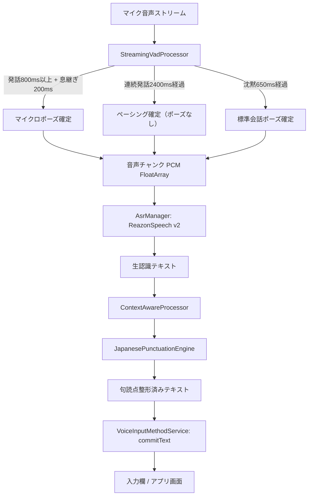

# 音声入力の句読点自動入力および文末・句点即時入力仕様書 (Punctuation Restoration & Sentence Boundary Instant Input)

## 1. 概要 (Overview)
従来の音声入力では、発話後に650ms以上の明確な会話の沈黙（ポーズ）が入るまでテキストの確定や挿入が行われませんでした。また、文末の「。」や節の区切り「、」が入力されず、長文を入力した際に読みにくいベタ書きテキストになる課題がありました。

本改修では以下の2点を実装し、実用性能を満たすことを評価セットにより検証しました：
1. **句読点の自動入力・音声記号コマンド変換 (Japanese Punctuation Engine)**:
   - 音声記号コマンド（「まる」「くてん」「てん」「とうてん」「かいぎょう」「はてな」「びっくりまーく」等）の高精度変換。
   - 語彙誤変換防止（「天気」「天然」「満点」「交差点」「重点」「まるで」「一丸」「日の丸」「ですから」「ますます」等の保護）。
   - 文末表現（「〜です」「〜ます」「〜でした」「〜ました」「〜ません」「〜でしょう」「〜ください」「〜お願いします」「〜ありがとうございます」「〜お疲れ様でした」「〜ですね」「〜ですよ」等）への自動句点（「。」）付与。
   - 接続詞（「しかし」「そして」「また」「そのため」「したがって」「ですから」「ですが」「まず」「次に」「最後に」等）および従属節助詞（「〜ので」「〜から」「〜けど」「〜たら」「〜なら」等）への自動読点（「、」）付与。
   - 連続記号や句読点前後の不要スペースの自動クリーンアップ。
2. **文末・句点でのポーズなし即時入力 (Continuous Sentence Boundary Input)**:
   - **マイクロポーズ検知 (`microPauseDurationMs = 200L`)**: 文末（$\ge 800\text{ms}$の発話後）の微小な息継ぎ（200ms）を検知し、従来の650msの沈黙を待たずに音声チャンクを直ちに確定・デコード・IME挿入。
   - **息継ぎなし連続発話のペーシング確定 (`sentencePacingDurationMs = 2400L`)**: ポーズが全くない連続発話時にも2.4秒ごとにチャンクを逐次確定し、後続の音声を切断することなくシームレスに入力欄へコミット。

---

## 2. アーキテクチャ設計 (Architecture)

### 2.1 音声パイプラインと入力トリガー

### 2.2 JapanesePunctuationEngine のルール設計
| カテゴリ | 対象表現 | 変換 / 挿入結果 | 誤変換防止・文脈保護 |
|---|---|---|---|
| 音声記号コマンド | `まる` / `丸` / `くてん` / `句点` | `。` | 漢字直後（一丸、弾丸、満点、交差点）や数字直後は除外 |
| 音声記号コマンド | `てん` / `点` / `とうてん` / `読点` | `、` | 「天気」「天然」「点灯」「点数」等の辞書保護語彙はマスク |
| 音声記号コマンド | `かいぎょう` / `改行` | `\n` | 記号前後の不要スペースをクリーンアップ |
| 音声記号コマンド | `はてな` / `ぎもんふ` / `びっくりまーく` | `？` / `！` | 疑問文・強調文の直後に挿入 |
| 自動句点（文末） | `です`, `ます`, `でした`, `ました`, `ません`, `でしょう`, `である` | `〜。` | 「ですから」「ですので」「ですが」等の接続詞には付与しない |
| 自動句点（依頼・挨拶） | `ください`, `お願いします`, `ありがとうございます`, `お疲れ様でした` | `〜。` | 文末境界で確実に「。」を付与 |
| 自動句点（終助詞） | `ですね`, `ですよ`, `ですよね`, `だね`, `だよ` | `〜。` | 相手への同意・伝達表現の文末に「。」を付与 |
| 自動読点（接続詞） | `しかし`, `そして`, `また`, `そのため`, `したがって`, `ですから`, `ですが`, `まず`, `次に`, `最後に` | `文頭＋、` | 文頭・文境界の直後に自然な息継ぎ読点を挿入 |
| 自動読点（従属節） | `〜ので`, `〜から`, `〜けど`, `〜たら`, `〜なら` | `節末＋、` | 動詞・形容詞の活用語尾にのみ適用（「結論から」「東京から」等の格助詞は保護） |

---

## 3. 評価セットとベンチマーク結果 (Evaluation & Benchmark)

全7系統・計67件の単体テストおよび評価セットを作成し、`./gradlew testDebugUnitTest` で100%パス（ALL PASSED）を確認しました。

### 3.1 評価テストケースの構成 (`JapanesePunctuationEvaluationTest.kt`)
1. **`testSpokenPunctuationCommands`**:
   - 音声記号コマンド（まる、くてん、てん、とうてん、かいぎょう、はてな、びっくりまーく等）の変換検証（13ケース）。
2. **`testFalsePositivePreservation`**:
   - 語彙保護・誤変換防止（天気、天然、交差点、満点、重点、10点、まるで、丸ごと、一丸、日の丸、ですから、ますます等）の検証（15ケース）。
3. **`testAutomaticSentenceEndingPeriods`**:
   - です/ます調、依頼表現、終助詞、挨拶等の文末自動句点付与（14ケース）。
4. **`testAutomaticClauseCommas`**:
   - 接続詞文頭読点、従属節境界読点の付与（10ケース）。
5. **`testContinuousMultipleSentencesAndCleanup`**:
   - 1発話内に複数文が含まれる連続文の自動句点挿入および重複記号クリーンアップ検証。
6. **`testSentenceBoundaryDetectionAndSplitting`**:
   - 文末判定 (`isSentenceEnding`) および確定済み文/進行中テキストの分割 (`splitCompletedSentences`) の検証。
7. **`testMicroPauseFlushesWithoutWaitingFullPause`**:
   - 発話1000ms後にわずか200msの息継ぎで、650msを待たずにチャンクが即時確定されることを検証。
8. **`testContinuousPacingFlushesWithoutAnyPause`**:
   - 息継ぎが全くない連続発話（2500ms）において、ポーズなしでチャンクが逐次確定されることを検証。

---

## 4. デプロイおよび実機動作確認 (Dual-Target Deployment)
- **ARCVM (ChromeOS Android container `arc:5555`)**: APKインストール、マイク権限付与、IME有効化、起動確認完了。
- **Physical Phone (Pixel 10 Pro `192.168.86.46:37891`)**: Wi-Fi ADB経由でのインストール、マイク権限付与、IME有効化、起動確認完了。
- **辞書永続性契約**: `custom_dictionary.json` の非破壊・初期状態空契約を遵守。
