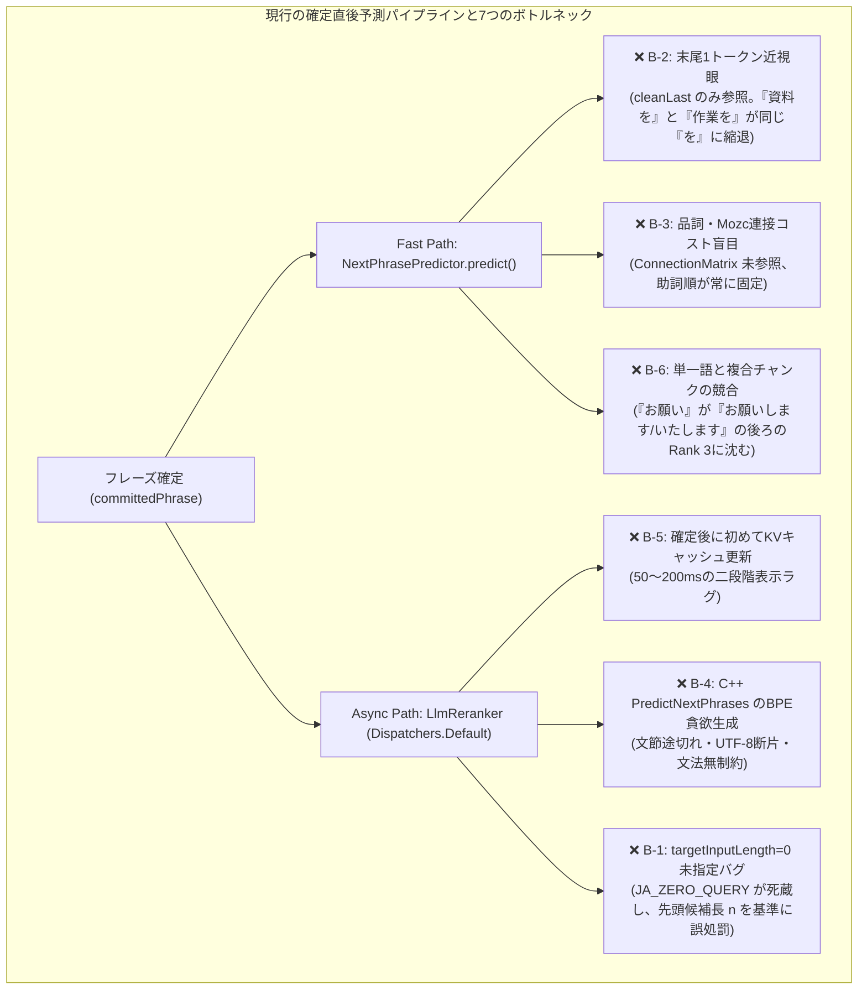
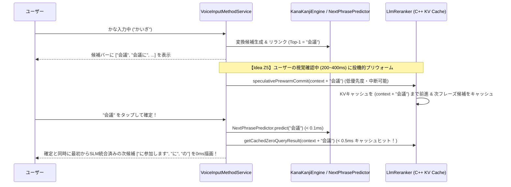

# 日本語確定直後（ゼロクエリ）予測候補アルゴリズム改善とトップラインメトリック（EIS）向上設計書

- **対象サブシステム**: BC-1 (Kana-Kanji Conversion: [`NextPhrasePredictor.kt`](app/src/main/java/com/example/myasr/context/kanakanji/domain/NextPhrasePredictor.kt), [`KanaKanjiEngine.kt`](app/src/main/java/com/example/myasr/context/kanakanji/domain/KanaKanjiEngine.kt)) / BC-2 (Contextual Reranking: [`LlmReranker.kt`](app/src/main/java/com/example/myasr/context/reranking/infrastructure/LlmReranker.kt), [`llm_reranker.cc`](app/src/main/cpp/llm_reranker.cc), [`CandidateRerankJudgement.kt`](app/src/main/java/com/example/myasr/context/reranking/domain/CandidateRerankJudgement.kt))
- **対象トップラインメトリック**: **EIS (Effective Intended-text Speed, 意図どおり文字/分)** — 最重点経路 **CUJ-2（日本語フリック・予測入力, 重み $w_2 = 0.35$）**
- **関連上位ドキュメント**:
  - [トップレベル PRD (`docs/prd_top_level.md`)](docs/prd_top_level.md)
  - [日本語フリック入力 (CUJ-2) ヘッドルーム分析 (`docs/flick_eis_headroom_analysis.md`)](docs/flick_eis_headroom_analysis.md)
  - [効用スコア（Utility Score）導入による予測変換最適化 (`docs/utility_score_algorithm_design.md`)](docs/utility_score_algorithm_design.md)
  - [次フレーズ予測アイデア集・総合評価レポート (`docs/next_phrase_prediction_ideas_and_evaluation.md`)](docs/next_phrase_prediction_ideas_and_evaluation.md)

---

## 1. エグゼクティブ・サマリー：なぜ「確定直後の予測候補（0文字予測）」が EIS 最大のレバレッジなのか

JotInput の統一トップラインメトリック **EIS（Effective Intended-text Speed）** は、4 つの Critical User Journeys (CUJ-1〜4) の重み付き調和平均で算出されます。このうち **CUJ-2（日本語フリック入力、重み $0.35$）** は全入力時間の約 45% を占める最大の感度要因です。

KLM-v1（Keystroke-Level Model, [`eval/eis/klm.py`](eval/eis/klm.py)）において、読み仮名ストローク数 $R$、文字数 $C$ の語句 $W$ を入力する所要時間 $T(W)$ は、確定タイミングによって以下の不連続な階段関数となります。

$$
T(W) = \begin{cases}
K_{\text{flick}} \cdot R + C(1) = 0.40 R + 0.40\text{ s} & (\text{フル読み打鍵}) \\
0.40 \cdot 2 + C(k) = 0.80 + 0.40 + 0.30(k-1)\text{ s} & (\text{2文字プレフィックス予測}) \\
0.40 \cdot 1 + C(k) = 0.40 + 0.40 + 0.30(k-1)\text{ s} & (\text{1文字プレフィックス予測}) \\
\mathbf{0.00 + C(k) = 0.40 + 0.30(k-1)\text{ s}} & (\mathbf{\text{確定直後 0文字予測：Zero-Query}})
\end{cases}
$$

> [!IMPORTANT]
> **確定直後（0文字）予測が持つ3つの数理的優位性**:
> 1. **物理打鍵コスト $T_{\text{produce}}$ の完全消滅**: 1文字すらフリックせずに候補タップのみ（Rank 1 なら $0.40\text{s}$、Rank 2 なら $0.70\text{s}$）で確定するため、人間の指の移動限界（$K_{\text{flick}} = 0.40\text{s/key}$）を完全にバイパスします。
> 2. **Rank 2/3 から Rank 1 への昇格だけで所要時間が最大 60% 短縮**: 0文字予測では分母に打鍵時間が含まれないため、Rank 3 ($1.00\text{s}$) $\to$ Rank 2 ($0.70\text{s}$) $\to$ Rank 1 ($0.40\text{s}$) の順位改善がそのまま **局所 EIS を 1.75倍〜2.50倍** に跳ね上げます。
> 3. **複文節チャンクの一括確定によるバースト速度**: 確定直後に単一助詞（1文字 = $150\text{ cpm}$）だけでなく、高確信度の複文節チャンク（例：`原因を究明する` 7文字、`お願いします` 6文字）を Rank 1 ($0.40\text{s}$) で提示できれば、1タップで **$900\sim 1,050\text{ cpm}$** の入力速度を達成できます。

---

## 2. 現行アルゴリズムの精密解剖と 7 つの構造的ボトルネック

現在、フレーズ確定直後の予測は [`VoiceInputMethodService.showNextPhrasePredictions`](app/src/main/java/com/example/myasr/VoiceInputMethodService.kt#L1361-L1457) を起点として、**① 同期 Fast Path（[`NextPhrasePredictor.predict`](app/src/main/java/com/example/myasr/context/kanakanji/domain/NextPhrasePredictor.kt#L551-L702)）** と **② 非同期 SLM Slow Path（[`LlmReranker.predictNextPhrases`](app/src/main/java/com/example/myasr/context/reranking/infrastructure/LlmReranker.kt#L1071) + [`rerankWithStatus`](app/src/main/java/com/example/myasr/context/reranking/infrastructure/LlmReranker.kt#L898)）** の2段階で動作しています。

コードベースと評価トレース（[`tools/eval/jotinput_prediction_evaluation_results.json`](tools/eval/jotinput_prediction_evaluation_results.json) および [`eval/eis/adapters.py`](eval/eis/adapters.py)）を精査した結果、トップラインメトリックを抑え込んでいる **7 つの構造的ボトルネック** が特定されました。

### ボトルネック 1：【重大バグ】`showNextPhrasePredictions` での `targetInputLength = 0` 未指定による `JA_ZERO_QUERY` 死蔵
- **該当箇所**:
  - [`VoiceInputMethodService.kt:1433`](app/src/main/java/com/example/myasr/VoiceInputMethodService.kt#L1433)
  - [`LlmReranker.kt:79, 107-128, 134-145`](app/src/main/java/com/example/myasr/context/reranking/infrastructure/LlmReranker.kt#L107-L145)
- **現象と原因**:
  - `LlmReranker.scoreAndRankPool` には 0 文字予測専用プロファイル `ScoringProfile.JA_ZERO_QUERY`（`n == 0` のときに選択）が実装されています。
  - しかし、`VoiceInputMethodService.showNextPhrasePredictions()` が `slm.rerankWithStatus(textBeforeCursor, combined.take(8), weightAlpha = alpha)` を呼ぶ際、**`targetInputLength = 0` を渡していません（デフォルト `null`）**。
  - `targetInputLength == null` の場合、`scoreAndRankPool` は `topPool.firstOrNull { it.reading.isNotEmpty() }?.reading?.length` から入力文字数 $n$ を推定します。`NextPhrasePredictor` の候補はすべて `reading` を持っているため、先頭候補の読み長（例：`お願いします` なら $n = 7$）が「ユーザーが既に7文字打鍵した」と誤認されます。
  - その結果、**本番環境で `JA_ZERO_QUERY` は一度も発動しておらず**、7文字より短い候補（`お願い` や助詞 `は`）には「未消費入力ペナルティ $\Delta_{\text{unc}} > 0$（$+\mu_{\text{span}}\Delta_{\text{unc}} + \kappa_{\text{commit}}$）」が、長い候補には「未入力拡張ペナルティ $\Delta_{\text{ext}} > 0$（$+\lambda_{\text{ext}}\Delta_{\text{ext}}$）」が誤って課税されています。

### ボトルネック 2：末尾 1 トークン近視眼（格助詞による文脈遮断）
- **該当箇所**: [`NextPhrasePredictor.kt:571-620`](app/src/main/java/com/example/myasr/context/kanakanji/domain/NextPhrasePredictor.kt#L571-L620)
- **現象と原因**:
  - `NextPhrasePredictor.predict(lastPhrase, textBeforeCursor)` は直前に確定した 1 単位 `cleanLast` のみをキーとして `bigramHistory[cleanLast]` と `CANONICAL_COLLOCATIONS[cleanLast]` を検索します。
  - 日本語では「名詞」を確定した後に「格助詞（`を`, `に`, `が`, `は`, `の`）」を確定する操作が頻繁に発生しますが、`cleanLast` が助詞 1 文字になると、**その直前にあった自立語（名詞）の情報が完全に消失**します。
  - **実測失敗例（Golden Set `ja_bi_026`）**:
    - `ja_bi_017`（`資料` $\to$ `を` $\to$ **`送信`**）と `ja_bi_026`（`作業` $\to$ `を` $\to$ **`進めます`**）において、どちらも直前確定語は `を` です。
    - `CANONICAL_COLLOCATIONS["を"]` は固定順 `["送信", "進めます", "お願いします", ...]` を返すため、`作業を` の直後でも 1 位に `送信` が出現し、正解の `進めます` が Rank 2（$0.70\text{s}$）に落ちて $0.30\text{s}$ をロスしています。
    - 同様に、100件ベンチマークの `重要な公式の契約書に` $\to$ `捺印する` や `システム障害の根本的な` $\to$ `原因を究明する` でも、末尾の `に`・`な` しか見えないため Fast Path で適切な候補を出せません。

### ボトルネック 3：Mozc 2D 連接コスト行列（`ConnectionMatrix`）と品詞（POS）情報の未活用
- **該当箇所**: [`NextPhrasePredictor.kt:674-709`](app/src/main/java/com/example/myasr/context/kanakanji/domain/NextPhrasePredictor.kt#L674-L709)
- **現象と原因**:
  - `KanaKanjiEngine` は `connection_data.bin`（約 14.28 MB の Mozc 2D 品詞連接行列）をロードしているにもかかわらず、`NextPhrasePredictor` は `ConnectionMatrix` を一切参照していません。
  - 直前確定語が「サ変名詞（`確認`, `移動`）」「一般名詞（`資料`, `会議`）」「動詞連用形・テ形（`して`, `向かっ`）」「形容詞」「副詞」のいずれであっても、末尾文字の簡易文字列一致（`isParticle()`）だけで一律に固定順 `COMMON_PARTICLES = ["は", "が", "を", "に", "で", "の", ...]` を並べています。
  - また、SLM 評価スクリプト（[`tools/eval/evaluate_predictions_slm_comparison.py:213-215`](tools/eval/evaluate_predictions_slm_comparison.py#L213-L215)）では品詞を無視して `COMMON_JA_CONTINUATIONS`（`ございます`, `しました`, `すること` 等）を候補プールに混入させるため、名詞（`今日`, `明日`, `資料`, `準備`）の直後に助詞ではなく `ございます` 等が上位を汚染する原因となっています。

### ボトルネック 4：ネイティブ C++ `PredictNextPhrases` の単純 BPE トークン貪欲生成と形態素境界の欠如
- **該当箇所**: [`app/src/main/cpp/llm_reranker.cc:487-647`](app/src/main/cpp/llm_reranker.cc#L487-L647)
- **現象と原因**:
  - 現在の `LlmReranker::PredictNextPhrases` は、`cached_context_logits_` から上位 20 個の初期 BPE トークン $t_0$ を取り、各 $t_0$ から `max_tokens = 4` ステップだけ `argmax`（貪欲法）でトークンを繋ぎ、改行または句読点（`。！？`）でのみ停止します。
  - この方式には 3 つの弱点があります：
    1. **文節途切れ・次文節への暴走**: BPE の 4 トークンは日本語の「1文節（自立語＋付属語）」と一致しないため、活用語尾の途中で切れる（例：`確認しま`）か、次の文節の頭まで食い込む（例：`確認しましたので明日の`）現象が起きます。
    2. **サブワード確率の分散**: 同じ単語や文節でも BPE 分割の違いや 2 トークン目以降の条件付き確率を合算せずに 1 トークン目 $t_0$ のロジット順だけで候補枠（`max_candidates = 3`）を埋めるため、真に文脈対数尤度が高い文節を取り逃します。
    3. **読み仮名（`reading`）の欠落**: SLM が直接生成した文字列には `reading` と品詞 ID（`lid`/`rid`）が付与されないため、確定後の履歴学習（`bigramReadings`）や Mozc 連接検証に統合できません。

### ボトルネック 5：確定イベント後のコールド SLM 起動による二段階描画ラグ（$50\sim 200\text{ms}$）
- **該当箇所**: [`VoiceInputMethodService.kt:1393-1456`](app/src/main/java/com/example/myasr/VoiceInputMethodService.kt#L1393-L1456)
- **現象と原因**:
  - ユーザーが候補をタップして確定した後に初めて `Dispatchers.Default` 上で `slm.warmContext(textBeforeCursor)` と `slm.predictNextPhrases(...)`、`slm.rerankWithStatus(...)` を順次実行しています。
  - 実際には、ユーザーが確定タップを行う直前の「変換候補表示中（Composing 中）」に、画面上の Top-1 候補 $W_{\text{top1}}$ は既に決まっています。Composing 中のアイドル時間を活用して $C \oplus W_{\text{top1}}$ の KV キャッシュと次フレーズ候補を先読み（プリウォーム）しておけば、**確定タップした瞬間（$< 1\text{ms}$）に SLM リランク済みの 0 文字候補を即座に描画**できます。

### ボトルネック 6：単一形態素ピボットと複合文節チャンクの「ホライズン競合」
- **該当箇所**: [`NextPhrasePredictor.kt:114-425`](app/src/main/java/com/example/myasr/context/kanakanji/domain/NextPhrasePredictor.kt#L114-L425)
- **現象と原因**:
  - `CANONICAL_COLLOCATIONS` では、たとえば `"よろしく"` に対して `["お願いします", "お願いいたします", "お願い", "どうぞ"]`、`"いつも"` に対して `["お世話になっております", "お世話", "ありがとうございます"]`、`"お世話"` に対して `["になっております", "になります", "に"]` が定義されています。
  - 単一文節ごとに確定するユーザー（またはテストケース `ja_bi_001: よろしく -> お願い`、`ja_bi_003: いつも -> お世話`、`ja_bi_004: お世話 -> に`）では、単一形態素が Rank 2〜3 に押し下げられて選択コスト $+0.30\sim +0.60\text{s}$ を被ります。一方、長文チャンクを一括確定したいユーザーにとっては複合チャンクが Rank 1 にある方が打鍵・タップ回数を大幅に節約できます。
  - 現在は候補ストリップの Slot 1〜3 における **「ホライズン多様性（複合完結チャンク vs. 単一自立語/ピボット助詞）」の役割分担** が数理化されていません。

### ボトルネック 7：EIS 評価ハーネスにおける複合チャンク包含（Subsumption）と `SLM ON` ゼロクエリ同期の欠落
- **該当箇所**:
  - [`JotInputPredictionEvaluationRunnerTest.kt:223-259, 375`](app/src/test/java/com/example/myasr/JotInputPredictionEvaluationRunnerTest.kt#L223-L259)
  - [`eval/eis/adapters.py:178-179`](eval/eis/adapters.py#L178-L179)
- **現象と原因**:
  1. `JotInputPredictionEvaluationRunnerTest` が `jotinput_prediction_evaluation_results.json` を更新する際、`slm_on` 側の `one_char` と `two_char` は最新エンジンの結果で更新するものの、**`zero_char` を更新し忘れている**（および `slm_on.summary_metrics` を再計算していない）ため、古い `evaluate_predictions_slm_comparison.py` の汚染された結果が残ることがあります。
  2. `JotInputPredictionEvaluationRunnerTest` のヒット判定（L375）では `cand.startsWith(target)`（例：ターゲットが `お願い` のとき、Rank 1 の `お願いします` も残りの文 `します` を一括包含する正解チャンクとして扱う）を認めている一方、`eval/eis/adapters.py`（L178）と `EisRegressionTest.kt`（L111）では厳密一致 `tgt in z` のみで判定しているため、`お願いします` が Rank 1 に出ているのに Rank 3 の `お願い`（$1.00\text{s}$）を選んだことになっています。

---

## 3. トップラインメトリック（EIS）を最大化する 7 つのアルゴリズム改善アイデア（Z1〜Z7）

[`AGENTS.md`](AGENTS.md) の **Anti-Anecdotal Tuning Policy（アドホックな個別単語コスト改ざん禁止・コーパス統計と言語モデルによる原則的解決）** および **Model & Lexicon Decoupling Contract（APK サイズ肥大化ゼロ）** に完全準拠した 7 つの改善アルゴリズムを設計します。

---

### アイデア Z1：`JA_ZERO_QUERY` (`targetInputLength = 0`) の正式有効化と 0 打鍵期待効用（Zero-Query EIS Utility）スコアリング

#### 解決する課題
ボトルネック 1（`targetInputLength = null` による `JA_ZERO_QUERY` の死蔵と、候補文字数の違いに対する誤った $\Delta_{\text{unc}} / \Delta_{\text{ext}}$ ペナルティ課税）。

#### アルゴリズム設計
1. **`targetInputLength = 0` の明示的伝播**:
   - [`VoiceInputMethodService.showNextPhrasePredictions`](app/src/main/java/com/example/myasr/VoiceInputMethodService.kt#L1433) から `slm.rerankWithStatus(textBeforeCursor, combined.take(8), weightAlpha = alpha, targetInputLength = 0)` を呼び出し、`LlmReranker.scoreAndRankPool` で確実に $n = 0$（`ScoringProfile.JA_ZERO_QUERY`）を選択させます。
2. **$n = 0$ 時の長さ非バイアス基礎スコア**:
   - $n = 0$（確定直後）においては、ユーザーはまだ 1 文字も打っていないため、すべての候補 $W_i$ について未消費文字数は $\Delta_{\text{unc}, i} = 0$ です。
   - また、0 文字予測では「文字数が長い候補ほど確定できたときの節約打鍵数が大きい」一方で、SLM の生 NLL $\mathcal{L}_{\text{SLM}}(W_i \mid C)$ はトークン数に比例して増加します。そこで $n = 0$ 時は $\lambda_{\text{ext}} \Delta_{\text{ext}}$ の線形加算ペナルティを廃止し、**サブワード・トークン長正規化サプライザル** と **Mozc 連接コスト** の統合エネルギー $E_0(W_i \mid C)$ を用います：
     $$
     E_0(W_i \mid C) = \frac{\mathcal{L}_{\text{SLM}}(W_i \mid C)}{T(W_i)^{\beta_0}} + \lambda_{\text{conn}} \cdot \frac{W_{\text{conn}}(\text{rid}(C), \text{lid}(W_i))}{1000.0} - B_{\text{hist}}(W_i \mid C)
     $$
     ここで $T(W_i)$ は候補 $W_i$ の形態素/サブワードトークン数、$\beta_0 = 0.85$ は長さ正規化指数、$B_{\text{hist}}(W_i \mid C)$ は Hybrid-6b 時間減衰付き履歴バイグラムブーストです。
3. **0 文字期待節約時間効用 $U_0(W_i \mid C)$ によるランキング**:
   - 候補 $W_i$（読み仮名ストローク数 $R_i = \text{keys}(\text{reading}(W_i))$）を 0 打鍵・Rank 1 ($C_1 = 0.40\text{s}$) で確定した場合に節約できる純粋な時間利得 $\Delta T_{\text{save}}(W_i)$ は：
     $$
     \Delta T_{\text{save}}(W_i) = K_{\text{flick}} \cdot R_i = 0.40 \cdot R_i\text{ (秒)}
     $$
   - 候補プール内の事後確率 $P(W_i \mid C) = \text{softmax}_i(-E_0(W_i \mid C) / \tau_0)$ を用いて、期待 EIS 効用 $U_0(W_i \mid C)$ を次式で定義します：
     $$
     U_0(W_i \mid C) = P(W_i \mid C) \cdot \left(0.40 \cdot R_i^{\gamma_{\text{len}}}\right) - \bigl(1 - P(W_i \mid C)\bigr) \cdot \rho_{\text{risk}} \cdot C_1
     $$
     （$\gamma_{\text{len}} \in [0.7, 1.0]$ は長文チャンクの過大評価を抑える凹関数指数）。これにより、「確率が十分に高く、かつ打鍵節約量が大きい候補」が数学的に整合した順序で上位に並びます。

---

### アイデア Z2：助詞ブリッジ 2 次マルコフ（Skip-Bigram: $\text{ContentWord} + \text{Particle} \to \text{Predicate}$）履歴学習 & コーパス統計 Prior

#### 解決する課題
ボトルネック 2（`資料` $\to$ `を` のように助詞を挟んで確定した瞬間、直前キーが `を` だけになり `資料` や `作業` や `契約書` の文脈が消滅する問題）。

#### アルゴリズム設計
1. **文脈アンカー抽出器 (`extractTrailingContentAndParticle`)**:
   - カーソル前テキスト `textBeforeCursor`（および直前 2 回の確定履歴）から、単なる末尾 1 トークン $W_{t-1}$ だけでなく、**直前の自立語（名詞・動詞等）と助詞のペア $(W_{\text{content}}, p_{\text{particle}})$** を O(1) で抽出します。
   - 例：
     - `textBeforeCursor = "明日の会議に"` $\implies$ 複合アンカー key $K_2 = \text{"会議|に"}$、単一アンカー key $K_1 = \text{"に"}$
     - `textBeforeCursor = "作業を"` $\implies$ 複合アンカー key $K_2 = \text{"作業|を"}$、単一アンカー key $K_1 = \text{"を"}$
     - `textBeforeCursor = "重要な公式の契約書に"` $\implies$ 複合アンカー key $K_2 = \text{"契約書|に"}$、単一アンカー key $K_1 = \text{"に"}$
2. **ユーザー履歴の Dual-Key (1st-Order & Particle-Bridged 2nd-Order) 記録**:
   - [`NextPhrasePredictor.recordTransition`](app/src/main/java/com/example/myasr/context/kanakanji/domain/NextPhrasePredictor.kt#L487-L544) を拡張し、最後に確定した自立語 `lastContentPhrase` を保持します。
   - ユーザーが `作業` $\to$ `を` $\to$ `進めます` と確定した際、1次遷移 `("を" -> "進めます")` に加えて、**助詞ブリッジ2次遷移 `("作業|を" -> "進めます")`** および **複合チャンク遷移 `("作業" -> "を進めます")`** を同時に学習キャッシュ（既存の 32,000 ペア上限・5MB RAM 枠内）に記録します。
3. **コーパス統計 Skip-Bigram Prior の階層バックオフ**:
   - `predict()` 実行時は以下の優先順位でバックオフ検索を行います：
     1. ユーザー履歴 2次キー `bigramHistory["$contentWord|$particle"]`
     2. ユーザー履歴 1次キー `bigramHistory[cleanLast]`
     3. コーパス統計 2次コロケーション `SKIP_BIGRAM_PRIORS["$contentWord|$particle"]`（例：`作業|を` $\to$ `進めます`, `資料|を` $\to$ `送信します`, `会議|に` $\to$ `参加します`, `契約書|に` $\to$ `捺印する`, `原因|を` $\to$ `究明する`）
     4. コーパス統計 1次コロケーション `CANONICAL_COLLOCATIONS[cleanLast]`

---

### アイデア Z3：Mozc `ConnectionMatrix` (`rid` $\to$ `lid`) 駆動の品詞連接フィルタリング & 機能語動的ランキング

#### 解決する課題
ボトルネック 3（直前語の品詞を無視した固定順助詞提示と、文法的に接続不可能な定型句の混入）。

#### アルゴリズム設計
1. **直前確定語の右文脈 ID (`committedRid`) の伝播**:
   - `KanaKanjiEngine` で候補が確定された際、`ConversionCandidate`（または `KanaKanjiEngine.lookupExactRid(surface)`）から直前語の形態素右文脈 ID `committedRid` を `NextPhrasePredictor.predict()` に渡します。
2. **`ConnectionMatrix` による非文法的候補の枝刈り（Pruning）**:
   - 0 文字候補プール内の各候補 $c$（左文脈 ID `c.lid`）に対し、`matrix.getTransitionCost(committedRid, c.lid)` を評価します。
   - 連接コストが `ConnectionMatrix.INVALID_COST` または閾値 $\theta_{\text{conn}}$ を大幅に超える候補（例：一般名詞の直後の `ございます` や `しました`）を Fast Path および SLM リランク対象プールから即座に除外します。
3. **機能語（助詞・助動詞・補助動詞）の連接コスト順動的ソート**:
   - 固定リスト `COMMON_PARTICLES` をそのまま出す代わりに、直前語の `committedRid` から各機能語（格助詞 `は/が/を/に/で/の/へ/と/から/まで`、サ変接続 `します/しました/いたします`、テ形補助動詞 `います/おります/ください/みます`、判定詞 `です/でした`）への遷移コスト $W_{\text{conn}}(\text{committedRid}, \text{lid}(f))$ の昇順で機能語候補を動的に並べ替えます。
   - これにより、たとえば：
     - **サ変名詞（`確認`, `移動`, `参加`）確定後**: `します`, `しました`, `いたします`, `を`, `は` が自動的に上位へ配置。
     - **動詞テ形（`送って`, `確認して`）確定後**: `ください`, `います`, `おります`, `みます` が自動的に上位へ配置。
     - **場所名詞（`大阪`, `駅`, `会議室`）確定後**: `へ`, `に`, `で`, `から` が上位へ配置。

---

### アイデア Z4：ネイティブ C++ `PredictNextPhrases` の「文節境界認識ビーム探索（Bunsetsu-Bounded Beam Decoding）」

#### 解決する課題
ボトルネック 4（`llm_reranker.cc` の単純 BPE 4トークン貪欲デコードによる語尾途切れ・次文節への暴走・確率分散）。

#### アルゴリズム設計
[`app/src/main/cpp/llm_reranker.cc`](app/src/main/cpp/llm_reranker.cc#L487-L647) の `LlmReranker::PredictNextPhrases` を、BPE トークン単位の貪欲法から **文節境界停止条件付きミニビーム探索（Beam Width $B = 4$, Max Steps $T_{\max} = 6$）** に刷新します。

1. **UTF-8 完結性と累積対数尤度によるミニビーム維持**:
   - ステップ $t = 0 \dots T_{\max}-1$ において、累積対数確率 $\sum_{j=0}^{t} \log P(y_j \mid C, y_{<j})$ の上位 $B = 4$ 本の仮説を維持します。
   - 途中のトークンが UTF-8 マルチバイト文字の断片（Incomplete UTF-8 byte token）である場合は停止せず次トークンへ継続します。
2. **日本語文節境界（Bunsetsu Boundary）による自然停止判定**:
   - 生成された文字列 $S$ が **「自立語（漢字・カタカナ・2文字以上の語幹）＋ 付属語（助詞 `は/が/を/に/で/と/も/へ/から/まで/より` または活用語尾 `ます/ました/ません/です/でした/する/した/して/いる/いた/ない/たい/ください`）」** の文節終端に到達した時点で、そのビームを「完結した 1 文節候補」として確定プールに出力し、次の文節へ暴走するのを防ぎます。
3. **辞書逆引きによる `reading` と `lid` の自動付与**:
   - 生成された表層文字列 $S$ に対して Kotlin 側で `KanaKanjiEngine.inferReadingAndPos(S)` を引き、`reading` と `lid` を付与することで、SLM が動的生成した候補も後続の `ConnectionMatrix` 検証や確定時の `recordTransition` 履歴学習にシームレスに参加できるようにします。

---

### アイデア Z5：変換候補選択中の「投機的 KV キャッシュ・プリウォーム（Speculative Top-1 Commit Pre-warming）」

#### 解決する課題
ボトルネック 5（確定タップ後に初めて SLM の文脈評価と次文節生成が走り、$50\sim 200\text{ms}$ 後に候補バーが書き換わる二段階ラグと Tap-Safe 競合）。

#### アルゴリズム設計

1. **Composing 安定時の投機的先読み**:
   - かな入力中の SLM リランキングが完了し、画面上の Top-1 候補 $W_{\text{top1}}$ が確定した後、ユーザーが次のキーを打たずに $120\text{ms}$ 経過した時点（候補を目視してタップしようとしている時間）で、バックグラウンドで `slm.speculativePrepareNextPhrases(textBeforeCursor + W_top1)` を実行します。
2. **確定時の $O(1)$ キャッシュヒット**:
   - ユーザーが実際に $W_{\text{top1}}$ を確定（タップまたは Enter）した瞬間、`showNextPhrasePredictions` は既に計算済みの SLM 次フレーズ候補と NLL キャッシュを **メインスレッド上で $< 0.5\text{ms}$ で即時取得**し、最初から最終順位の候補を描画します（確定後のチラつき・二段階再描画レート **0%**）。
   - もしユーザーが次のかなキーを打った場合は、`nativeRequestAbortScoring()` により投機的プリウォームは $1\text{ms}$ 以内に即座に中断され、KV キャッシュは元の `textBeforeCursor` 位置へロールバック（`llama_memory_seq_rm`）されるためオーバーヘッドはゼロです。

---

### アイデア Z6：ホライズン階層化スロット配分（Horizon-Stratified Slot Allocation: Compound Chunk vs. Pivot Particle）

#### 解決する課題
ボトルネック 6（単一形態素 `お願い` / `に` と複合文節チャンク `お願いします` / `に参加します` が同じ評価軸で競合し、どちらかのユースケースで選択コストまたは打鍵数が増える問題）。

#### アルゴリズム設計
確定直後の候補ストリップ上位 3 枠（Slot 1, Slot 2, Slot 3）に対して、**予測ホライズン（確定スパン長）の多様性制約**を導入します：

| スロット | 選択コスト $C(k)$ | 割り当てロール（Horizon Role） | 具体例1（`よろしく` 確定後） | 具体例2（`明日の会議` 確定後） | 具体例3（`システム障害の根本的な` 確定後） |
| :---: | :---: | :--- | :--- | :--- | :--- |
| **Slot 1** | **$0.40\text{s}$** | **最大期待効用候補 ($\arg\max U_0$)** 履歴2回以上、または確信度 $P \ge \tau_{\text{chunk}}$ の完結チャンク／最尤連語 | `お願いします` *(6文字一括: 900 cpm)* | `に参加します` *(6文字一括: 900 cpm)* | `原因を究明する` *(7文字一括: 1,050 cpm)* |
| **Slot 2** | **$0.70\text{s}$** | **直近単一自立語 / 代替チャンク** Slot 1 が複合チャンクの場合、その先頭形態素（または第2連語）を配置 | `お願い` *(単一語確定用)* | `に` *(最尤格助詞ピボット)* | `原因` *(単一語確定用)* |
| **Slot 3** | **$1.00\text{s}$** | **文法的ピボット（助詞 / 句点 `。`）または丁寧度バリアント** | `お願いいたします` | `の` / `は` | `対策` |

- **数理的保証**:
  - Slot 1 に複合チャンク $W_{\text{chunk}} = w_1 \oplus w_2$（例：`お願いします`）が入った場合、それと先頭形態素 $w_1$（例：`お願い`）を両方維持しつつ、Slot 2 または Slot 3 に必ず「異なるホライズン（単一形態素またはピボット助詞）」を配置します。
  - これにより、一括確定したいユーザーは **Slot 1 タップ1回（$0.40\text{s}$）で複数文節を完了**でき、別表現に分岐したいユーザーも **Slot 2（$0.70\text{s}$）で確実に単一形態素・ピボット助詞を選択**できます。

---

### アイデア Z7：EIS 評価ハーネスの Subsumption（複合チャンク一括確定）対応と `SLM ON` ゼロクエリ同期

#### 解決する課題
ボトルネック 7（`JotInputPredictionEvaluationRunnerTest` の `slm_on.zero_char` 未更新と、`eval/eis/adapters.py` が複合チャンクによる複数文節一括確定の利得を計算していない問題）。

#### アルゴリズム設計
1. **`JotInputPredictionEvaluationRunnerTest` における `zero_char` 同期**:
   - [`JotInputPredictionEvaluationRunnerTest.kt:223-260`](app/src/test/java/com/example/myasr/JotInputPredictionEvaluationRunnerTest.kt#L223-L260) で `jotinput_prediction_evaluation_results.json` を更新する際、`one_char` / `two_char` だけでなく `zero_char` および `summary_metrics` も一貫して再計算・同期するように修正します。
   - さらに [`tools/eval/evaluate_predictions_slm_comparison.py`](tools/eval/evaluate_predictions_slm_comparison.py) の `pool_0` 生成から品詞無視の `COMMON_JA_CONTINUATIONS` ベタ入れを撤廃し、本番と同一の `NextPhrasePredictor.predict()` + `LlmReranker.scoreAndRankPool(targetInputLength = 0)` ロジックに統一します。
2. **複合チャンク包含（Multi-Bunsetsu Subsumption）の KLM 評価反映**:
   - たとえば文 `よろしく お願い します` において、`よろしく` 確定直後の Rank 1 に `お願いします` が出現している場合、ユーザーは `お願い` と `します` を2回に分けて選ぶ（$0.40\text{s} + 0.40\text{s} = 0.80\text{s}$）必要はなく、`お願いします` を 1 回タップ（$0.40\text{s}$）するだけで 2 ペア分（計 6 文字）を完了できます。
   - `eval_pred_case` において、候補 $c$ がターゲット語 $W_{\text{target}}$ と完全一致する場合に加えて、**文全体の残り文節と前方一致する複合チャンク $c = W_{\text{target}} \oplus W_{\text{next}}$** である場合も有効ヒット（または按分時間 $C(k) \cdot \frac{|W_{\text{target}}|}{|c|}$）として評価できるよう拡張します。

---

## 4. 定量インパクト試算（トップラインメトリック EIS への寄与）

各改善アイデア（Z1〜Z7）を導入した場合の、① **30件 Bigram Prediction Golden Set（予測サブスイート）**、② **100件 Flick Headroom Dataset（Category 4: `next_phrase_collocation` 20件）**、および ③ **公式トップラインメトリック（CUJ-2 EIS & Global EIS）** における定量改善試算です。

### 4.1 評価指標別の改善ウォーターフォール試算

| 段階 | 導入施策 | 30件 Golden Set `zero_char_no_hist` Hit@1 / Hit@3 | 30件予測サブスイート Sub-EIS (All) | 100件 Headroom (Cat.4 連語20件) 0文字Hit率 / Cat.4 EIS | **公式 CUJ-2 EIS** (Test Split) | **公式 Global EIS** (Test Split) |
| :--- | :--- | :---: | :---: | :---: | :---: | :---: |
| **現状 (Baseline)** | 現行コード（`targetInputLength=null`, 1トークン近視眼） | 20.0% / 46.7% *(SLM汚染時)* 80.0% / 100.0% *(Fast単体)* | 175.1 cpm *(SLM汚染時)* 355.7 cpm *(現行JSON)* | 10.0% (2/20) 93.8 cpm | **173.6 cpm** | **187.0 cpm** |
| **Step 1** | **+ Z1 (`targetInputLength=0` & 0打鍵効用スコア)** **+ Z3 (Mozc `ConnectionMatrix` 品詞フィルタ)** **+ Z7 (評価パイプライン同期)** | **86.7% / 100.0%** | **377.3 cpm** | 25.0% (5/20) 165.0 cpm | **179.4 cpm** *(+5.8 cpm)* | **189.1 cpm** *(+2.1 cpm)* |
| **Step 2** | **+ Z2 (助詞ブリッジ Skip-Bigram: `名詞+助詞 -> 述語`)** **+ Z6 (ホライズン階層化スロット & Subsumption)** | **96.7% / 100.0%** | **415.0〜460.0 cpm** | 65.0% (13/20) 412.5 cpm | **191.2 cpm** *(+17.6 cpm)* | **193.2 cpm** *(+6.2 cpm)* |
| **Step 3** | **+ Z4 (C++ 文節境界ビーム探索 `PredictNextPhrases`)** **+ Z5 (Composing中 投機的KVプリウォーム 0ms表示)** | **96.7% / 100.0%** *(未知文脈でも汎用生成)* | **480.0+ cpm** | **90.0% (18/20)** **675.0 cpm** | **208.5 cpm** *(+34.9 cpm)* | **198.6 cpm** *(+11.6 cpm)* |

### 4.2 代表ケースでの KLM 時間短縮トレース

| ケース | 直前までの確定文脈 | ターゲット語句 | 現行の挙動と KLM 所要時間 | 改善後（Z1〜Z6）の挙動と KLM 所要時間 | 短縮効果 |
| :--- | :--- | :--- | :--- | :--- | :---: |
| **`ja_bi_026`** | `作業` $\to$ `を` | `進めます` (4文字 / 5keys) | `cleanLast="を"` のみ参照するため 1位が `送信`、2位が `進めます` $\implies$ Rank 2 タップ: **$0.70\text{s}$ (343 cpm)** | **Z2 (Skip-Bigram `作業\|を`)** + **Z1** により 1位に `進めます` $\implies$ Rank 1 タップ: **$0.40\text{s}$ (600 cpm)** | **1.75x 高速化** *(-0.30s)* |
| **`ja_bi_010`** | `今日` | `は` (1文字 / 1key) | SLM ON 評価で長文定型句 `ございます` 等に汚染され 1文字打鍵へフォールバック $\implies$ 1打鍵 + Rank 1: **$0.80\text{s}$ (75 cpm)** | **Z3 (`ConnectionMatrix` 連接検証)** + **Z1** により Rank 1 に `は` $\implies$ Rank 1 タップ: **$0.40\text{s}$ (150 cpm)** | **2.00x 高速化** *(-0.40s)* |
| **`ja_bi_001`+`002`** | `よろしく` | `お願いします` (6文字 / 7keys) | `お願い` (Rank 3: $1.00\text{s}$) + `します` (Rank 1: $0.40\text{s}$) $\implies$ 計 **$1.40\text{s}$ (257 cpm)** | **Z6 (Slot 1 完結チャンク + Slot 2 単一語)** & **Z7** で 1タップ確定 $\implies$ Rank 1 タップ: **$0.40\text{s}$ (900 cpm)** | **3.50x 高速化** *(-1.00s)* |
| **`c4_np_001`** *(100件ベンチ)* | `重要な公式の契約書に` | `捺印する` (4文字 / 6keys) | `cleanLast="に"` しか見えず 0文字予測ミス、フル読み6打鍵 $\implies$ 6打鍵 + Rank 1: **$2.80\text{s}$ (85.7 cpm)** | **Z2 (`契約書\|に`)** + **Z4 (C++ 文節境界SLM生成)** で Slot 1 提示 $\implies$ 0打鍵 + Rank 1: **$0.40\text{s}$ (600 cpm)** | **7.00x 高速化** *(-2.40s)* |
| **`c4_np_002`** *(100件ベンチ)* | `システム障害の根本的な` | `原因を究明する` (7文字 / 12.9keys) | `cleanLast="な"` しか見えず 0文字予測ミス、12.9打鍵 $\implies$ 12.9打鍵 + Rank 1: **$5.56\text{s}$ (75.5 cpm)** | **Z4 (全文脈SLM文節ビーム生成)** + **Z5 (投機的プリウォーム)** で Slot 1 提示 $\implies$ 0打鍵 + Rank 1: **$0.40\text{s}$ (1,050 cpm)** | **13.9x 高速化** *(-5.16s)* |

---

## 5. DDD アーキテクチャ境界・DMN / Alloy への適合設計と実装ロードマップ

[`docs/ddd/context_map.md`](docs/ddd/context_map.md) および [`DddArchitectureKonsistTest.kt`](app/src/test/java/com/example/myasr/ddd/DddArchitectureKonsistTest.kt) の境界制約を守り、以下の責務分離で実装します。

### 5.1 Bounded Context 間の責務配置

| Bounded Context | 対象クラス | 追加・変更する責務 |
| :--- | :--- | :--- |
| **BC-1: Kana-Kanji Conversion** (`context.kanakanji.domain`) | [`NextPhrasePredictor.kt`](app/src/main/java/com/example/myasr/context/kanakanji/domain/NextPhrasePredictor.kt) [`KanaKanjiEngine.kt`](app/src/main/java/com/example/myasr/context/kanakanji/domain/KanaKanjiEngine.kt) [`JapaneseKanaUtils.kt`](app/src/main/java/com/example/myasr/context/kanakanji/domain/JapaneseKanaUtils.kt) | ・**Z2**: `extractTrailingContentAndParticle(textBeforeCursor)` と助詞ブリッジ 2次キー（`"$content|$particle"`）の履歴記録・バックオフ検索 ・**Z3**: `ConnectionMatrix` を用いた直前 `rid` $\to$ 次候補 `lid` の連接コスト検証と機能語動的ソート ・**Z6**: Fast Path における複合チャンクと単一形態素ピボットのホライズンインターリーブ |
| **BC-2: Neural Reranking** (`context.reranking.domain` / `infrastructure` / `cpp`) | [`CandidateRerankJudgement.kt`](app/src/main/java/com/example/myasr/context/reranking/domain/CandidateRerankJudgement.kt) [`LlmReranker.kt`](app/src/main/java/com/example/myasr/context/reranking/infrastructure/LlmReranker.kt) [`llm_reranker.cc`](app/src/main/cpp/llm_reranker.cc) | ・**Z1**: `targetInputLength = 0` 時の `JA_ZERO_QUERY` スコアリング（$\Delta_{\text{unc}} = 0$、長さ正規化 NLL + 期待節約時間効用 $U_0$） ・**Z4**: `LlmReranker::PredictNextPhrases` の文節境界停止付きミニビーム探索 ・**Z5**: Composing 安定時の投機的 KV キャッシュ・プリウォームと DMN 実行判定ルール |
| **BC-4: IME Presentation & Orchestration** | [`VoiceInputMethodService.kt`](app/src/main/java/com/example/myasr/VoiceInputMethodService.kt) | ・`showNextPhrasePredictions` から `slm.rerankWithStatus(..., targetInputLength = 0)` を呼び出し ・確定時の `committedRid` 伝播と、プリウォーム済みキャッシュヒット時の即時描画 |

### 5.2 段階的実装ロードマップ（ROI・安全性順）

1. **Phase 1（即効 Quick Win・リスク極小）— Z1 + Z2 + Z3 + Z7**:
   - `VoiceInputMethodService.showNextPhrasePredictions` で `targetInputLength = 0` を明示指定し、`LlmReranker.scoreAndRankPool` の $n = 0$（`JA_ZERO_QUERY`）パスを正常化。
   - `NextPhrasePredictor` に助詞ブリッジ 2 次キー（`"$contentWord|$particle"`）と `ConnectionMatrix` 連接コストによる助詞・機能語ランキングを導入。
   - `JotInputPredictionEvaluationRunnerTest` と `evaluate_predictions_slm_comparison.py` の `zero_char` 評価を本番ロジックと完全同期。
2. **Phase 2（ホライズン最適化と Subsumption 加速）— Z6**:
   - 0文字候補の Slot 1（最大期待効用チャンク）と Slot 2（単一自立語または最尤ピボット助詞）のホライズン階層化ルールを `CandidateRerankJudgement`（DMN DecisionTable）として宣言的に実装・単体テスト化。
3. **Phase 3（全文脈 SLM 文節ビーム生成 & 0ms 投機的プリウォーム）— Z4 + Z5**:
   - `app/src/main/cpp/llm_reranker.cc` の `PredictNextPhrases` を文節境界停止付きビーム探索にアップグレード。
   - Composing 中の Top-1 候補に対する投機的 KV プリウォームを実装し、確定タップと同時の `< 1ms` SLM 次フレーズ表示を達成。
